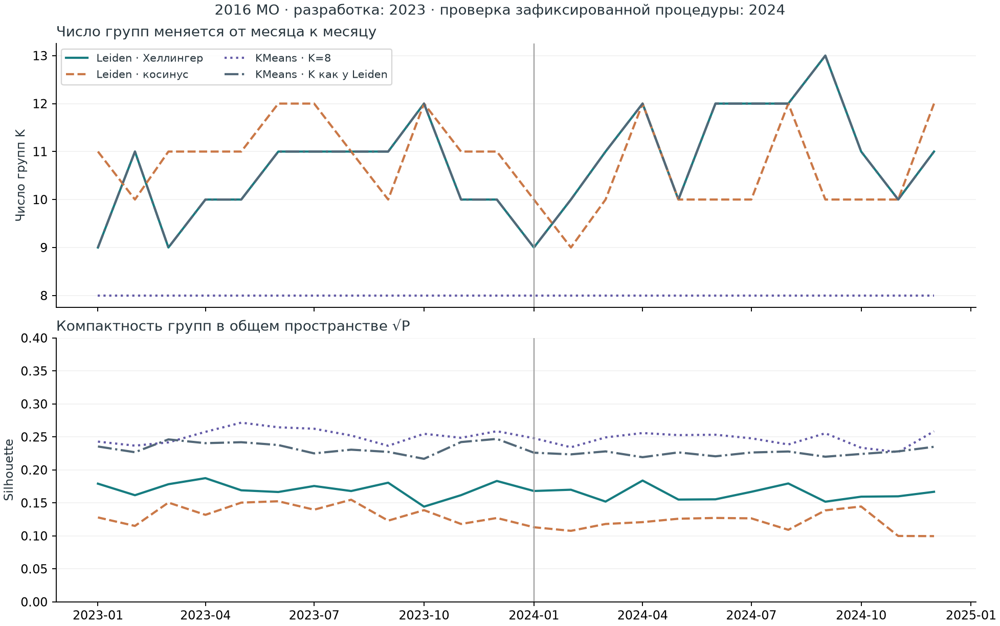
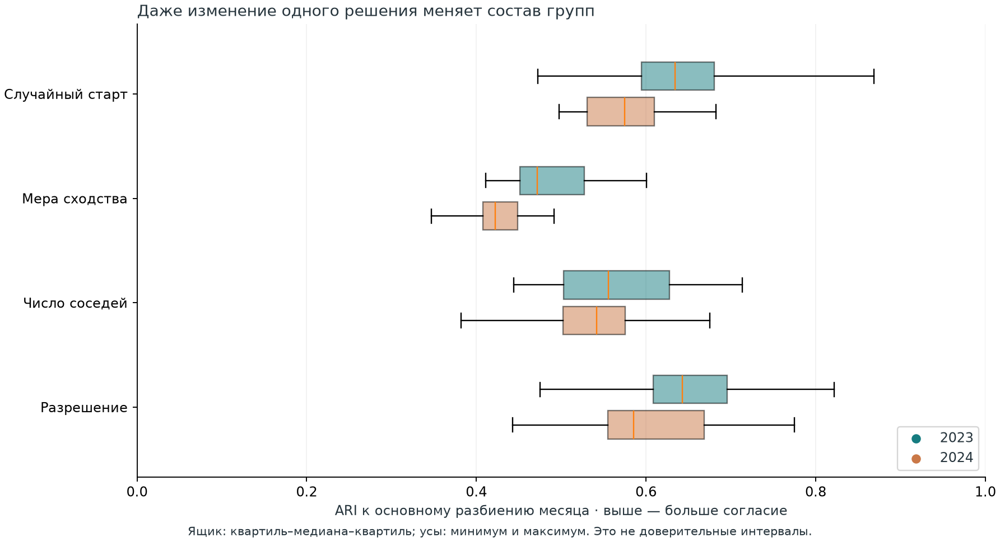
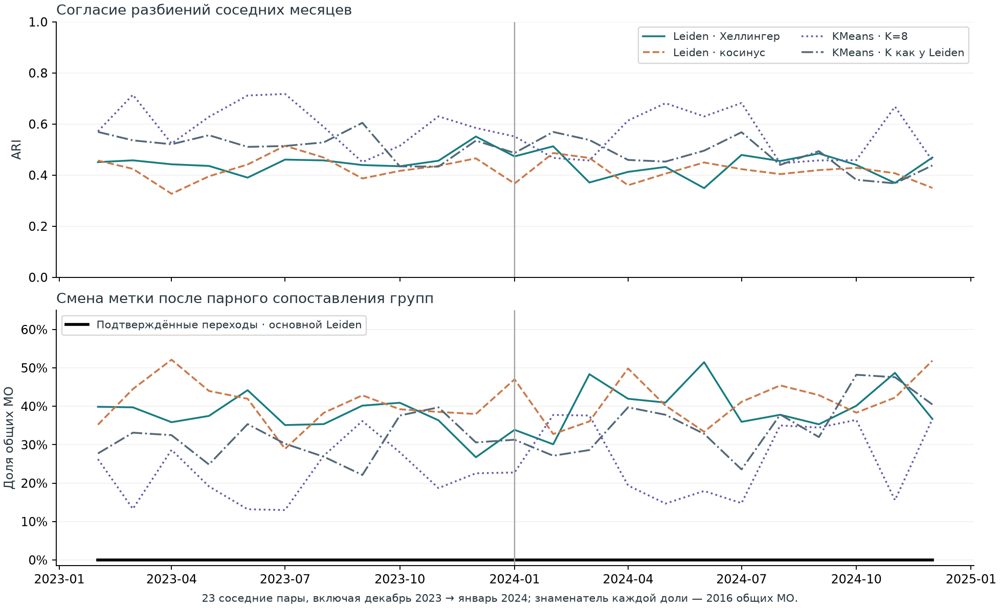

# Потребительские профили муниципалитетов

**Динамические сети сходства, экономическая интерпретация и устойчивость кластеризации.** Направление «Кластеризация», конкурс СберИндекса 2026.

Мы исследовали 2016 российских муниципалитетов за 24 месяца 2023–2024 годов. Построили помесячные атрибутированные сети, сравнили четыре метода группировки и сопоставили результаты с населением, зарплатой, отраслевой занятостью, ценами и доступностью рынков.

**Главный результат:** потребительские профили имеют экономически содержательные различия, но границы сообществ чувствительны к методу. Поэтому мы представляем сами различия, качество группировки и поддержку отдельных назначений. Устойчивую типологию локальных экономик выбранная процедура не подтвердила.

[PDF-презентация](submission/PRESENTATION.pdf) · [Методологический отчёт](submission/METHODOLOGY.md) · [Воспроизведение](submission/REPRODUCE.md) · [Архивы данных](submission/DATA.md)

## Данные и метод

| Компонент | Решение |
|---|---|
| Единица анализа | Муниципальное образование, ключ `territory_id` |
| Основная панель | 2016 МО × 24 месяца; 48 384 наблюдения |
| Атрибуты узла | Пять нормированных показателей расходов: продовольствие, здоровье, маркетплейсы, общественное питание, транспорт |
| Связь | Сходство Хеллингера между профилями; объединение списков 20 ближайших соседей |
| Основная кластеризация | Leiden, разрешение 1,0, seed 13 |
| Сравнение | Leiden на косинусной сети; KMeans с K = 8; KMeans с числом групп основного Leiden |
| Проверка чувствительности | 21 альтернатива в каждом месяце: геометрия, число соседей, разрешение и seed |
| Время | Согласование групп по максимальному пересечению; сохранение полных потоков и проверка парной поддержки |

Для пяти опубликованных значений расходов x нормированный профиль задаётся как `p_ic = x_ic / sum_c(x_ic)`. Сходство двух МО: `s_ij = sum_c(sqrt(p_ic * p_jc))`. Ребро включается, если хотя бы один из узлов выбрал другой среди ближайших соседей.

Нормировка отделяет соотношение показателей от их общего уровня. Эти компоненты нельзя автоматически считать точными долями семейного бюджета: общий знаменатель исходных категориальных средних не раскрыт. Рёбра характеризуют сходство, а не наблюдаемые потоки товаров или денег.

Основная процедура разработана на 2023 годе и применена к 2024-му после фиксации кода, параметров и данных. Последующие проверки обогащения и географии исследовательские, после просмотра обоих лет. [Протокол](docs/experiment_protocol.md) · [Конфигурация](configs/robustness_v1.json).

## Экономические различия профилей

Население, зарплата организаций и концентрация учитываемых рабочих мест помогают описывать различия потребления. В 2024 году ранговая корреляция населения с координатой общепита равна 0,716; после вычитания среднего глобального ранга соответствующего региона она составляет 0,729. Для зарплаты и общего уровня расходов значения равны 0,855 и 0,666. Выборки парно доступных данных различаются: 2013 МО для населения и 2000 для зарплаты.

Эти связи описывают экономические градиенты и не устанавливают причинность. Зарплата организаций не равна доходу жителей, а число рабочих мест в МО отличается от числа занятых жителей. [Экономический анализ](reports/enriched_analysis/REPORT.md).

Восемь отраслевых показателей добавляют информацию о составе профиля сверх базовых экономических признаков и индикаторов пропусков. В 2024 году на 1998 МО снижение квадратичной ошибки составляет **1,38% внутри регионов** и **7,34% при удержании целых регионов**. Это описание данных того же года на объектах вне обучения, а не прогноз будущего.

95% интервалы для этих оценок равны [0,36%; 2,43%] и [2,71%; 11,51%]. Они получены перевыборкой регионов по фиксированным ошибкам и не учитывают повторное обучение. На малой выборке с полным раскрытием восьми отраслей качество ухудшается; универсальная польза для всех МО не установлена. [Отраслевые проверки](reports/round2_analysis/REPORT.md).

## Сравнение методов

Все 24 основных графа связны. Leiden выделяет 9–12 групп в 2023 году и 9–13 в 2024-м. По месяцам минимальный размер группы составляет 59–147 МО, доля крупнейшей группы 11,21–17,81%.

Медианы по месяцам 2024 года:

| Метод | SW ↑ | CH ↑ | AVI ↑ | AVU ↓ | MQ ↑ | S_Dbw: определено месяцев |
|---|---:|---:|---:|---:|---:|---:|
| Leiden, Хеллингер | 0,163 | 785,31 | 0,815 | 0,537 | 0,716 | 2/12 |
| Leiden, косинус | 0,119 | 688,64 | 0,857 | 0,543 | 0,750 | 8/12 |
| KMeans, K = 8 | 0,249 | 1079,86 | 0,822 | 0,540 | 0,689 | 8/12 |
| KMeans, сопоставимое K | 0,226 | 939,77 | 0,788 | 0,525 | 0,690 | 0/12 |

KMeans даёт более компактные группы. Основной Leiden имеет более высокую модульность общей сети Хеллингера. Сетевые индексы косинусного Leiden относятся к другой сети, поэтому таблица не задаёт единого рейтинга экономического качества.

S_Dbw при нулевом знаменателе плотности оставлен неопределённым. На опорных месяцах основной метод лучше контрольных перестановок по SW, CH, AVI и MQ, но хуже по AVU. Все шесть индексов рассчитаны с явными конвенциями; согласованного положительного вердикта всех метрик нет. Под MQ используется взвешенная модульность Newman–Girvan. [Формулы](docs/metrics.md) · [Полная таблица](reports/initial_study/method_metrics.csv).

## Насколько устойчив состав групп

ARI измеряет согласие разбиений независимо от номеров меток. Смена геометрии даёт медианный ARI 0,472 в 2023 году и 0,422 в 2024-м. Даже смена только seed при неизменной сети меняет разбиение: медианы ARI равны 0,634 и 0,575.

Для каждого МО сравнивается множество остальных участников его группы. Альтернатива поддерживает назначение при Jaccard ≥ 0,8; итоговый фильтр требует минимум 17 из 21 альтернативы.

| Период | Прошли фильтр | Всего назначений МО × месяц | Медиана среднего Jaccard |
|---|---:|---:|---:|
| 2023 | 66 | 24 192 | 0,455 |
| 2024 | 0 | 24 192 | 0,411 |

Все 66 назначений относятся к августу 2023 года. Пороги строгие и операционные; они не оценивают вероятность существования истинного типа. Нулевой итог ограничивает доверие к меткам выбранной процедуры и не доказывает отсутствия экономической структуры.

## Динамика и переходы

После попарного согласования меток основной Leiden показывает 18 008 смен на 46 368 пар соседних месяцев и 11 018 смен на 24 192 пары год к году. Ни одна не проходит парный фильтр устойчивости.

Фильтр требует поддержки обоих концов и воспроизведения смены одними и теми же минимум 17 альтернативами. Максимум совместной поддержки концов составляет 14/21, поэтому ограничение возникает ещё до проверки самой смены. Сырые переходы нельзя использовать как подтверждённый список экономических шоков.

Годовое сглаживание не восстановило поддержку Leiden. Межгодовой ARI годового разбиения равен 0,3253; у KMeans с K = 8 он составляет 0,6631. Более высокая согласованность KMeans в этом сравнении не подтверждает существование восьми экономических типов. [Годовая проверка](reports/enriched_analysis/annual_networks/README.md) · [Таблицы потоков](reports/initial_study/flows.csv).

## Пространственная интерпретация

В декабре 2024 года дорожные расстояния внутри групп на 0,73% меньше условного случайного ориентира с сохранением регионального состава. В июне аналогичная проверка не получила поддержки. Доступность рынков различается между группами сверх регионального состава в обоих месяцах.

Исключение 78 МО со сменой ОКТМО или типа сохраняет эти выводы. Это фильтрация готовых назначений, без нового обучения. Расстояния относятся к концу 2024 года, индекс доступности к 2024 году целиком. Размер МО и пространственная автокорреляция дополнительно не контролируются; причинные эффекты не оцениваются. [Пространственный анализ](docs/reviews/spatial_validation.md).

## Что дали дополнительные источники

| Источники | Итог исследования |
|---|---|
| Региональный ИПЦ | Медианный рост расходов между годами составляет 15,12% номинально и 6,09% после корректировки; у 113 МО знак меняется с плюса на минус |
| Инвестиции, отгрузка и розница | Дополнения повысили полноту данных, но не дали устойчивого прироста описательной модели профиля |
| Региональные публикации Ставрополья и Саратовской области | Положительная связь с уровнем расходов на 33 и 38 МО; после учёта населения и урбанизации на сокращённых выборках все четыре интервала включают ноль |
| Документы по аэропорту Черский | Кассовые расходы нельзя напрямую приравнивать к статистическим муниципальным инвестициям; вклад проекта в пик не установлен |
| Исторические коды МСП | Кандидатные соответствия сохранены отдельно; исторические адреса и принятые присоединения к МО не подтверждены |

[Обогащённый анализ](reports/enriched_analysis/REPORT.md) · [Денежные показатели](reports/round5_analysis/REPORT.md) · [Региональные проверки](reports/round6_analysis/REPORT.md).

## Использование и ограничения

Результаты позволяют сопоставлять потребительские профили, видеть экономические различия и оценивать зависимость группировки от метода. Для территориальной аналитики полезно сохранять непрерывные характеристики и степень поддержки назначения, прежде чем использовать жёсткую метку группы.

Выводы ограничены выбранными признаками, алгоритмами и порогами, 24 месяцами наблюдений и ретроспективной полной панелью. Устойчивые типы локальных экономик и экономические шоки выполненными проверками не установлены. Более грубые группы или другие методы могут дать иной результат.

## Код, данные и подробные материалы

- [Методологический отчёт](submission/METHODOLOGY.md) и [PDF-презентация](submission/PRESENTATION.pdf).
- [Инструкция запуска](submission/REPRODUCE.md), [каталог первичных архивов](submission/DATA.md), [источники и атрибуция](DATA_ATTRIBUTION.md), [происхождение результатов](submission/PROVENANCE.md).
- `src/municipal_profiles/` содержит алгоритмы, `scripts/` команды расчёта, `configs/` параметры; зависимости закреплены в `uv.lock`.
- `reports/initial_study/` содержит назначения, профили групп, метрики, поддержку и переходы; `reports/` и `data/derived/reviews/` сохраняют подробные исследования и их проверки.
- [Автономный обзор HTML](index.html) и интерактивные отчёты [раунда 2](reports/round2_analysis/report.html), [раунда 5](reports/round5_analysis/report.html), [раунда 6](reports/round6_analysis/report.html) открываются после скачивания в браузере.

Подробные отчёты и QA сохраняют результаты и границы каждого этапа исследования. Основное изложение и итоговая интерпретация приведены выше и в методологическом отчёте.
