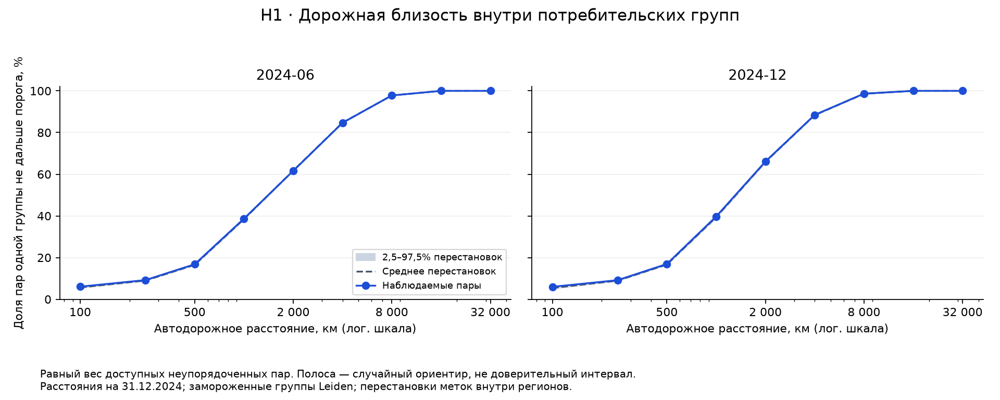
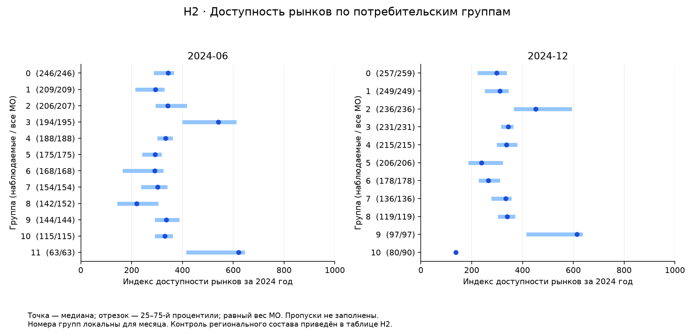

# Пространственный трек: дороги, доступность рынков и изменения справочника

Подготовлено 16 сентября 2026 года для трека appu-frog / @Card_1905.
Первый вклад по H3 дополнен 27 сентября 2026 года проверками H1/H2 из [пространственного брифа](../brief_spatial_validation.md).
Расчёт выполнен с помощью ИИ по переданному снимку репозитория; личная проверка участником и ревью команды ещё не выполнены.

Совместимость повторно проверена 27 сентября 2026 года с `main` на коммите `f6257537250ce279ce4be4a42f1f4d9235afe0ac` (17 сентября). Исходный ZIP побайтно соответствует всем 665 файлам коммита `e95a9cf`; после него появились восемь коммитов раундов 3–6. Все пять закреплённых входов этой проверки остались прежними, поэтому приведённые ниже результаты относятся и к текущему снимку этих входов. Проверка совместимости не заменяет научное ревью команды.

**Результат:** повышенная частота смен групп у 78 МО со сменой ОКТМО или типа не получила поддержки в выполненном контроле по регионам. Это не доказательство отсутствия связи. После исключения этих 78 МО устойчивых переходов по сохранённому критерию по-прежнему нет. Для остальных 1938 МО отсутствие флага означает только совпадение ОКТМО и типа в двух срезах справочника.

## Проверенный объём

Входы — сохранённые результаты `development-20260914-v1` и `evaluation-20260914-v1`, основной метод `leiden_hellinger`. Кластеризация и согласование меток заново не выполнялись. Полная исходная таблица расходов для этой проверки не нужна.

Из таблицы всех версий независимо заново выбраны срезы по правилу `year_from <= year < year_to`. На 2023-01-01 в справочнике 2596 записей, на 2024-01-01 — 2594. Во всех 2016 МО исследовательской выборки найдено ровно по одной записи каждого среза; пропущенных и неоднозначных соединений нет. ОКТМО сохранены строками, включая ведущие нули. Названия не служат ключами.

Флаг равен изменению `oktmo` **или** `municipal_district_type` между срезами. Пересчитанный набор 78 ID точно совпал с [предыдущим аудитом источника](../../reports/enrichment_v2/market_access_followup/sber_attribute_changes_78.csv). Регион у всех МО сохраняется. Справочник для передачи экономическому треку содержит обе версии типа, статуса и названия центра; это поля источника, а не независимая проверка центров на 2024 год.

## Что сравнивалось

Для каждого МО сначала считается доля `switched` в заданном наборе пар месяцев; затем среднее этих долей по двум группам МО. Все МО имеют одинаковый вес и одинаковое число пар внутри каждого окна. Строка перехода не считается отдельным независимым наблюдением. Использовано сохранённое попарное согласование `aligned_to_label`; простое сравнение исходных номеров групп неверно.

| Набор пар месяцев | Пар на одно МО | Со сменой атрибутов, 78 МО | Без флага, 1938 МО | Разница, п.п. | p после Holm |
|---|---:|---:|---:|---:|---:|
| Декабрь 2023 → январь 2024 | 1 | 30,77% | 34,00% | −3,23 | 0,3626 |
| Соседние месяцы внутри 2024 | 11 | 45,45% | 40,49% | +4,96 | 0,2607 |
| Одинаковые месяцы 2023 → 2024 | 12 | 46,58% | 45,50% | +1,08 | 0,3626 |

Сравнение случайное условно по регионам: 9999 раз перемешивается флаг изменения **между МО внутри каждого региона**, сохраняя число отмеченных МО в регионе. Месячная история МО при этом остаётся целой. Seed трёх окон: 1905, 1906, 1907. Для H3 заранее в коде задано направление «со сменой атрибутов переходов больше»: `p = (1 + число null >= observed) / 10000`. Поправка Holm относится к трём окнам, порог — 0,05.

Во всех окнах 78 отмеченных МО находятся в 17 регионах, включающих 405 МО общей выборки. В остальных регионах флаг постоянен и перестановка ничего не меняет. Это ограничивает информативность контроля. Средняя разница при случайной перестановке не обязана быть нулевой: для трёх окон она равна −5,45, +2,39 и −0,86 п.п. соответственно. Наблюдаемый избыток над этим ориентиром — +2,22, +2,57 и +1,94 п.п.; ни один не прошёл указанную проверку. Квантили перестановок в CSV — диапазон условного случайного ориентира, **не доверительный интервал эффекта**.

Перестановка опирается на условную обменность МО внутри региона. Урбанизация, размер населения и пространственная автокорреляция дополнительно не контролируются. Это описательная проверка ассоциации, а не причинная оценка преобразований.

## Что меняется после исключения 78 МО

| Набор пар | Все 2016 МО: доля обычных смен | Оставшиеся 1938 МО: доля обычных смен | Устойчивых переходов до / после |
|---|---:|---:|---:|
| Декабрь → январь | 33,88% | 34,00% | 0 / 0 |
| Соседние месяцы 2024 | 40,68% | 40,49% | 0 / 0 |
| Год к году | 45,54% | 45,50% | 0 / 0 |

Здесь фильтруются сохранённые переходы. Метод, граф и критерий устойчивости **не пересчитываются на сокращённой выборке**. Результат не отвечает на вопрос, изменится ли кластеризация после удаления этих МО до обучения. Для устойчивых переходов отдельный тест ассоциации не интерпретируется: исход содержит только нули.

## Ограничения

- Анализ исследовательский: результаты 2024 года уже опубликованы и просмотрены. Этот конфиг фиксирует воспроизведение нового расчёта, но не является пререгистрацией до знакомства с 2024 годом.
- Смена ОКТМО или типа не означает изменение границ. Точные юридические даты преобразований в этом модуле не проверялись; граница декабрь → январь не трактуется как дата административного события.
- Покрытие метаданных справочника заканчивается 2024-01-01. Полнота событий внутри 2024 года не установлена. `9999` — открытый конец исходного интервала, а не подтверждение актуальности до этой даты.
- Поле центра имеет ограничение датировки 2018 годом согласно [аудиту пространственных источников](../../reports/enrichment_v3/spatial/FINDINGS.md). Статус административного центра не превращён в независимо проверенный бинарный признак.
- Для H1 файл `connection.parquet` получен из `local-data-supplement.zip` в [релизе data-2026-09-15](https://github.com/roshlight/sberindex-clustering-submission/releases/tag/data-2026-09-15). Его SHA-256 совпал с каталогом источников и закреплён в конфигурации. Это прежний источник, а не новая выгрузка издателя.
- H2 за декабрь уже рассмотрена в [существующем анализе контекста](../../reports/enriched_analysis/cluster_context/README.md). Дополнение воспроизводит наблюдаемую статистику декабря и добавляет июнь и проверку после исключения 78 МО; прежняя работа не объявляется новым открытием.

Ветка содержит три описательные проверки брифа и внешнюю сверку региональных центров по изданиям 2024 года (раздел ниже). Полная юридическая история статусов и преобразований внутри 2024 года не установлена; ограничения исходного справочника сохраняются.

## H1/H2: внешние пространственные сравнения

Группы `leiden_hellinger` из `evaluation-20260914-v1` не переобучались. Июнь и декабрь, пороги охвата 95%, равные веса доступных неупорядоченных пар и 999 перестановок закреплены в [конфигурации](../../configs/spatial_external_review.json) до этого расчёта. Поскольку результаты 2024 года уже просматривались, это исследовательская проверка, а не новый holdout или пререгистрация.

H1 сравнивает среднее автодорожное расстояние внутри групп; меньшая величина поддерживает гипотезу. H2 использует долю межгрупповой суммы квадратов в общей дисперсии индекса (η²); большая величина поддерживает гипотезу. Метки МО перемешиваются внутри регионов отдельно на выборке с наблюдаемым источником, сохраняя число представителей групп в каждом регионе. Для H1 набор доступных пар остаётся фиксированным: пары не считаются независимыми наблюдениями. Для каждого сравнения `p = (1 + число не менее экстремальных перестановок) / 1000`; Holm применяется к четырём сравнениям H1/H2 × два месяца отдельно для полной выборки и проверки чувствительности.

| Проверка | Месяц | Наблюдаемое значение | Среднее перестановок | p Holm | Вывод |
|---|---|---:|---:|---:|---|
| H1, км | 2024-06 | 2126,27 | 2127,75 | 0,222 | Поддержки нет |
| H1, км | 2024-12 | 1899,12 | 1913,02 | 0,004 | На 13,89 км (0,73%) ближе |
| H2, η² | 2024-06 | 0,46575 | 0,41860 | 0,004 | Различия сверх регионального состава |
| H2, η² | 2024-12 | 0,53874 | 0,47109 | 0,004 | Различия сверх регионального состава |

Дорожный эффект мал и зависит от месяца. Для доступности рынков региональный состав уже объясняет значительную часть случайного ориентира; превышение η² над ним равно 0,04714 и 0,06765. Это не оценка причинного эффекта и не дополнительная доля дисперсии из регрессии с фиксированными эффектами. Обменность внутри региона — допущение; размер МО и пространственная автокорреляция дополнительно не контролируются. Дороги и индекс доступности связаны по смыслу и не являются двумя независимыми подтверждениями устойчивых экономических типов.

| Источник | Все МО: наблюдаемые / всего | Без флага: наблюдаемые / всего | Доступные пары: все / без флага |
|---|---:|---:|---:|
| Автодороги | 2006 / 2016 | 1929 / 1938 | 2 007 007 / 1 855 702 |
| Доступность рынков | 2004 / 2016 | 1927 / 1938 | Не применяется |

Охват пар относительно всех возможных пар выборки — 98,813% и 98,868%. Неоднозначных соединений нет; пропуски не заполнены. Отсутствие пары не означает отсутствие экономических связей. В полном дорожном источнике 3 303 736 уникальных неупорядоченных автодорожных пар; повторных обратных направлений нет. Железнодорожные строки исключены. Размеры групп, квартильные распределения, пропущенные ID и знаменатели сохранены в таблицах.

После исключения 78 МО выводы сохраняются: H1 июня `p Holm = 0,158`; H1 декабря — 1899,84 против 1914,77 км, `p Holm = 0,004`. Для H2 η² равно 0,46674 против 0,41909 в июне и 0,53958 против 0,47257 в декабре; оба `p Holm = 0,004`. Это фильтрация исходных назначений, без новой кластеризации. Отсутствие флага не подтверждает неизменность юридических границ.





Расстояния датированы 31.12.2024, индекс — всем 2024 годом: оба сравнения ретроспективные, доступность этих данных в июне не предполагается. Номера групп локальны для месяца. Полосы дорожного графика — квантили случайного ориентира, не доверительные интервалы эффекта.

## Воспроизведение дополнения H1/H2

Из архива `local-data-supplement.zip` указанного выше релиза нужен только член `work/sberindex-research/hackathon-bundle/hackathonlicence/connection.parquet`, размещённый в `data/raw/connection.parquet`. SHA-256 архива — `ffef5a042a026421e536dbcc6dbc0daf08dce30a3145b8a8b75416e9c454b575`; SHA-256 извлечённого файла — `20cbd5213d3ac1d0a867f097b485431811614b283d7366eb5cba9f65dc80493d`. Остальные входы уже хранятся в репозитории; индекс берётся из ранее проверенной таблицы `municipal_context_2024.parquet`, а не из новой полной выгрузки.

```powershell
uv run --frozen python scripts/review_spatial_external.py --output work/spatial-external-replay
uv run --frozen python scripts/plot_spatial_review.py --input work/spatial-external-replay --output work/spatial-external-replay/figures
uv run --frozen pytest tests/test_spatial_transition_review.py tests/test_spatial_external_review.py -q
uv run --frozen ruff check scripts/review_spatial_external.py scripts/plot_spatial_review.py tests/test_spatial_external_review.py
```

Выходной каталог должен быть новым. [Результаты H1/H2](../../data/derived/reviews/spatial_external_v1/) включают `spatial_checks.csv`, `spatial_coverage.csv`, `missing_ids.csv`, `group_summary.csv`, `road_cdf.csv`, `permutation_draws.csv`, `eligible_memberships.csv` и манифест с SHA-256 входов, кода и выходов. В `figures/` находятся обе иллюстрации в PNG/SVG и отдельный манифест. Семена восьми сравнений — 190527–190534; порядок задан конфигурацией и отражён в таблице проверок.

Локально прошли 25 тестов H3 и H1/H2 и Ruff. Независимый SQL-пересчёт по исходным дорожным парам, назначениям и индексу подтвердил все восемь наблюдаемых статистик и дорожные CDF. По 7992 сохранённым перестановкам повторно проверены средние, p и Holm; контрольные суммы таблиц совпали. Это проверка сохранённых перестановок, а не второй полный запуск генератора. Оба графика просмотрены. Среда та же, что указана ниже, плюс Matplotlib 3.11.2; полный набор тестов проекта и полная среда `uv.lock` не проверялись.

Перед отправкой вклад сверен с брифом: он проверяет внешнюю пространственную связь фиксированных потребительских групп, учитывает охват и исключение отмеченных МО и показывает отрицательный результат наряду с положительными. Новых моделей, причинных выводов и задач вне брифа нет. Такая самопроверка не заменяет ревью команды или оценку жюри.

## Передача экономическому треку: поля и ограничения

Сверено 2 октября 2026 года по неизменившемуся `main` (`f625753`) и ветке с расчётами (`6346b44`). Это передача предусмотренных брифом признаков, без новых гипотез. Все перечисленные поля уже находятся в [territory_crosswalk.csv](../../data/derived/reviews/spatial_transitions_v1/territory_crosswalk.csv); копировать справочник или соединять все исторические версии не требуется. Повторная сверка региона, ОКТМО, типа, статуса и названия центра с исходным срезом 2024 года подтвердила точное совпадение для всех 2016 МО.

| Поле | Допустимое использование | Ограничение |
|---|---|---|
| `territory_id` | Ключ соединения; одна строка справочника на МО | Название не заменяет ключ |
| `region_code_2024`, `region_name_2024` | Регион исходного среза | Код читать строкой |
| `oktmo_2024`, `oktmo_digits_2024` | Код в исходной записи и без разделителей | Читать строками, сохраняя ведущие нули |
| `municipal_district_type_2024` | Тип МО на срез 01.01.2024 | Не экономический тип потребительской группы |
| `municipal_district_status_2024` | Исходная положительная отметка статуса | Пусто означает «нет отметки», а не проверенное отрицание |
| `municipal_district_center_2024` | Название центра из выбранной версии | Суффикс обозначает срез версии; сведения о центре ограничены датировкой 2018 года |
| `year_from_2024`, `year_to_2024` | Интервал версии: нижняя граница включена, верхняя исключена | `9999` не доказывает актуальность после конца покрытия |
| `attribute_changed` | Изменение ОКТМО или типа между двумя срезами | Не признак юридически доказанного изменения границ |
| `join_status`, `source_url`, `metadata_coverage_through`, `center_reference_year` | Проверка соединения, происхождения и датировки | Сохранять при передаче вместе с признаками |

В когорте 980 муниципальных районов, 433 городских округа, 361 муниципальный округ и 242 внутригородские территории городов федерального значения; тип заполнен у всех 2016 МО. Название центра отсутствует у 242 МО. Статус `административный_центр_субъекта` заполнен у 64 МО, у 1952 статус пустой. **64 исходные отметки нельзя объявлять 64 независимо проверенными административными центрами на 2024 год.**

Неоднозначность следует проверять в полном срезе справочника, до ограничения исследовательской когортой: там 83 отметки в 81 регионе. В Калужской области помечены ID `1198` и `1207`, в Еврейской автономной области — `2338` и `2339`. Из 2016 МО 1691 относится к регионам с единственной отметкой, 31 — с двумя и 294 — без отметки. Эти числа характеризуют доступность регионального ориентира, а не число самих центров. Даже единственная отметка является свойством источника, а не независимым подтверждением статуса. См. [ранее выполненный аудит центров](../../reports/enrichment_v3/spatial/FINDINGS.md).

Пример безопасного соединения из корня проекта (все методы и месяцы назначений сохраняются; строки не размножаются):

```python
from pathlib import Path

import duckdb
import pandas as pd

root = Path.cwd()
crosswalk = pd.read_csv(
    root / "data/derived/reviews/spatial_transitions_v1/territory_crosswalk.csv",
    dtype={
        "region_code_2023": "string",
        "region_code_2024": "string",
        "oktmo_2023": "string",
        "oktmo_2024": "string",
        "oktmo_digits_2023": "string",
        "oktmo_digits_2024": "string",
    },
)
assignments = duckdb.read_parquet(str(root / "reports/initial_study/assignments.parquet")).df()
keys = ["territory_id", "month", "method"]
assert not crosswalk.territory_id.duplicated().any()
assert not assignments.duplicated(keys).any()
assert set(assignments.territory_id) == set(crosswalk.territory_id)
assert crosswalk.join_status.eq("matched_unique_both_snapshots").all()
joined = assignments.merge(
    crosswalk,
    on="territory_id",
    how="left",
    validate="many_to_one",
    indicator="spatial_join",
)
assert len(joined) == len(assignments)
assert joined.spatial_join.eq("both").all()
assert not joined.duplicated(keys).any()
```

Значения с суффиксом `_2024` в таком соединении остаются статическим контекстом 01.01.2024, включая строки назначений 2023 года. Для описания среза 2023 года следует брать уже сохранённые поля `_2023`; для сравнения изменений — обе версии. Статус центра не преобразуется в бинарный признак, пропуски не заполняются.

Передача исходных полей дополнена внешней сверкой ниже. Пустой исходный статус по-прежнему не означает проверенное отрицание. Производный признак читается отдельно с его источником, временным охватом и ограничениями муниципального уровня.

## Внешняя сверка региональных центров, 2 октября 2026 года

Использовано официальное издание [Росстата «Регионы России. Основные социально-экономические показатели городов. 2024»](https://rosstat.gov.ru/storage/mediabank/Region_Goroda_2024.pdf). Центры перечислены в восьми таблицах по федеральным округам: печатные страницы 16–17, 108–109, 162–163, 202–203, 236–237, 300–301, 334–335, 382–383. Это именно таблицы центров субъектов, а не списки крупнейших городов. Издание содержит показатели 2022–2023 годов и данные на начало 2024 года; оно не является реестром юридических изменений на каждый день 2024 года.

Вручную выбранные пары «регион — город-центр» сопоставлены с 80 конкретными ID городских округов в исходном срезе на 01.01.2024. Сохранены регион, ОКТМО, полное название муниципального образования и страницы доказательств. Код проверяет единственность ID и региона, тип городского округа и точное совпадение всех указанных полей с выбранной версией. Автоматическое объединение одноимённых городов не выполняется. Полная [таблица соответствий](../../data/derived/reviews/regional_centers_v1/reviewed_center_reference.csv) сохраняет 80 центров, включая отсутствующие в исследовательской когорте.

**Разрешены две неоднозначности:** для Калужской области выбран городской округ Калуга, ID `1198`, ОКТМО `29-701-000-000`; Кировский муниципальный район `1207` не совпадает с региональным центром. Для ЕАО выбран городской округ Биробиджан, ID `2338`, ОКТМО `99-701-000-000`; Биробиджанский район `2339` — другая муниципальная единица. То, что его органы находятся в Биробиджане, не делает район городским округом-центром. Страницы 39 и 423 дополнительно различают городские округа и города в статистике населения.

Для Гатчины [официальный отчёт Ленинградской области за 2023 год, опубликованный в 2024 году](https://kpb.lenobl.ru/media/uploads/userfiles/2024/05/02/2023_%D0%B3%D0%BE%D0%B4.pdf), печатная страница 3, подтверждает статус города с 3 апреля 2023 года. Но исходный ID `1397` обозначает Гатчинский муниципальный район. Статус города не переносится на район; для 18 МО региона точное сопоставление с муниципальной единицей-центром оставлено неопределённым. Тем самым выявлено и ограничение прежнего объяснения: отметки центра нельзя целиком датировать 2018 годом только по датировке координат.

| Результат для 2016 МО | Число | Значение `matches_reference_center_municipality` |
|---|---:|---|
| Совпадает с проверенным городским округом-центром | 61 | `True` |
| Другое МО в одном из 80 регионов с проверенным соответствием | 1643 | `False` |
| Ленинградская область: город подтверждён, муниципальный уровень не разрешён | 18 | Пусто |
| Внутригородские МО Москвы, Санкт-Петербурга и Севастополя: несопоставимый уровень | 242 | Пусто |
| Московская область: соответствие с муниципальным ID не подтверждено этим источником | 52 | Пусто |

`False` получен из несовпадения ID в регионе с проверенным соответствием, а не из пустого статуса Сбера. Среди 64 положительных исходных отметок 61 согласуется с внешним соответствием, две относятся к другим муниципальным единицам, одна — к Гатчинскому району с несопоставимым уровнем. Исходный `municipal_district_status_2024` сохранён без изменений. Этот признак характеризует совпадение с муниципальной единицей центра в датированном статистическом источнике; он не означает, что каждый населённый пункт городского округа является центром.

[Пакет проверки](../../data/derived/reviews/regional_centers_v1/) содержит таблицу соответствий, PDF-выписки из двух первичных изданий, URL и SHA-256 оригиналов и выписок. В `results/` находятся `municipality_center_review.csv` (2016 строк), `source_flag_review.csv` (64 строки), `coverage.csv` и манифест. Порядок страниц выписок и исходные индексы PDF записаны в `sources/receipts.json`. При скачивании Росстата цепочка TLS не была доверенной; использовано исключение проверки сертификата только для публичного запроса без учётных данных. Это ограничение транспорта отмечено в receipts; SHA-256 фиксирует полученные байты, но не заменяет проверку подлинности сертификата. Отчёт Ленинградской области скачан с обычной проверкой TLS.

Из корня репозитория, без сети и дополнительных PDF-библиотек:

```powershell
uv run --frozen python scripts/review_regional_centers.py --output work/regional-center-replay
uv run --frozen pytest tests/test_regional_center_review.py tests/test_spatial_transition_review.py tests/test_spatial_external_review.py -q
```

Для присоединения используйте `territory_id` и `validate="many_to_one"`, читая производный признак с `dtype={"matches_reference_center_municipality": "boolean"}`. Пустые значения не заполняйте `False`. Три новых теста проверяют различение города и района, сохранение неопределённости и отказ от неоднозначных ключей. Все 28 тестов прошли; повторная сборка дала побайтно одинаковые выходы. Расчёты H1–H3 не менялись: статус центра в них не использовался.

Проверка закрывает передачу **внешне подтверждённого статистического соответствия с явным охватом**, но не объявляет все 2016 МО юридически классифицированными на весь 2024 год. Такое ограничение существенно для приёмки и сохраняется в выводах и PR.

## Как этот вклад соотносится с раундами 3–6

Географическая проверка в проекте уже существенно продвинулась. В [третьем раунде](../../reports/data_round3/REPORT.md) проверена кодовая преемственность 131 населённого пункта и уточнены документы преобразований. В [четвёртом](../../reports/data_round4/REPORT.md) проверены версии геометрий четырёх приоритетных территорий. В [шестом](../../reports/data_round6/geography/README.md) добавлены шесть версий перекодировок ОКТМО, обработка неоднозначных переходов и кандидаты исторической принадлежности населённых пунктов. Это отдельные виды доказательств; они не заменяют определение узкого флага в настоящей проверке.

Существующая аналитика последних раундов описывает денежные показатели, их связь с расходами и пригодность исторических ключей МСП. Настоящее дополнение отвечает другому вопросу: связана ли неизменённая маска 78 МО с частотой уже сохранённых переходов потребительских групп. Здесь не переоцениваются юридические выводы новых раундов, не присоединяются исторические записи МСП и не объявляется отсутствие предыдущей пространственной работы.

## Воспроизведение и файлы

Из корня проекта в окружении Python 3.12 с зависимостями проекта:

```powershell
uv sync --frozen
uv run --frozen python scripts/review_spatial_transitions.py --output work/spatial-transition-replay
uv run --frozen pytest tests/test_spatial_transition_review.py -q
uv run --frozen ruff check scripts/review_spatial_transitions.py tests/test_spatial_transition_review.py
uv run --frozen ruff format --check scripts/review_spatial_transitions.py tests/test_spatial_transition_review.py
```

Каждый запуск требует нового каталога, чтобы не перезаписывать результаты. Скрипт не обращается к сети. Входные SHA-256 проверяются по [конфигурации](../../configs/spatial_transition_review.json); при другом снимке источников расчёт останавливается. Предложенные изменения не затрагивают старые числовые результаты, lock или ядро модели.

Фактический локальный запуск использовал Python 3.12.14, NumPy 2.3.5, pandas 3.0.1 и DuckDB 1.5.5. Это отдельное локальное окружение, а не подтверждение полного запуска проекта через `uv.lock`. Прошли 12 тестов нового модуля и его Ruff; отдельная SQL-сверка подтвердила знаменатели, частоты и число устойчивых переходов по исходным строкам. Повторный запуск в новый каталог воспроизвёл таблицы побайтно. Полный набор тестов проекта не запускался.

[Каталог результатов](../../data/derived/reviews/spatial_transitions_v1/):

| Файл | Содержание |
|---|---|
| `territory_crosswalk.csv` | 2016 строк: обе версии атрибутов, код региона, флаги изменений и статус соединения |
| `spatial_coverage.csv` | Охват двух срезов справочника |
| `spatial_checks.csv` | Три сравнения с числителями/знаменателями для устойчивых переходов, частотами обычных смен, случайным ориентиром и p |
| `municipality_transition_rates.csv` | 6048 строк: 2016 МО × 3 окна; числа пар и обычных/устойчивых смен |
| `permutation_draws.csv` | Все 29 997 перестановочных результатов |
| `manifest.json` | Контрольные суммы, параметры, версии среды, run_id и ограничения |

Основные источники — [сохранённый манифест исследования](../../reports/initial_study/report_manifest.json), [таблица версий](../../reports/enrichment_v1/crosswalk/municipal_crosswalk_versions.csv) и [аудит справочника](../../reports/enrichment_v1/crosswalk/municipal_crosswalk_audit.json). Использован переданный снимок, не новая выгрузка издателя. Атрибуция данных: СберИндекс, Росстат и другие источники согласно [DATA_ATTRIBUTION.md](../../DATA_ATTRIBUTION.md).
