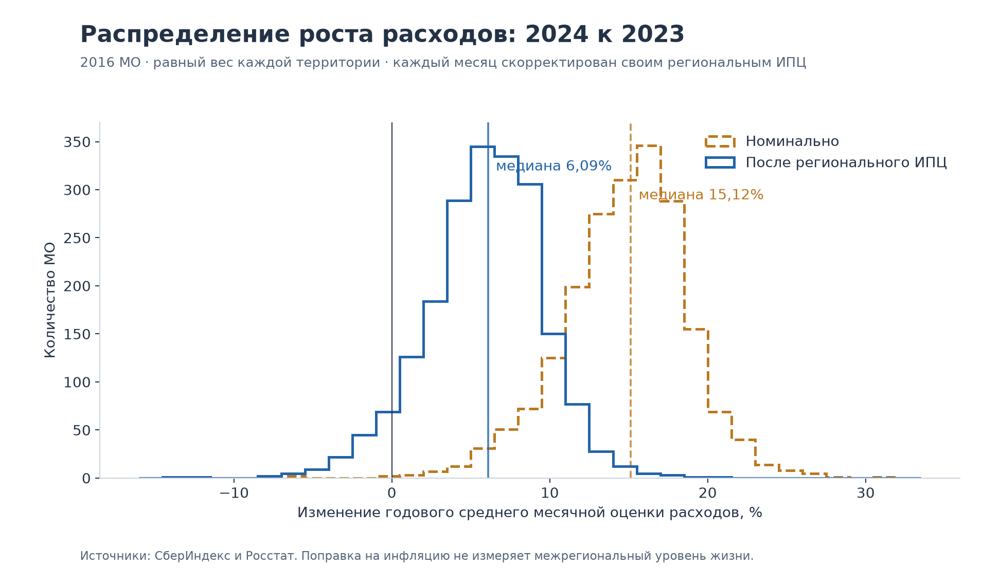
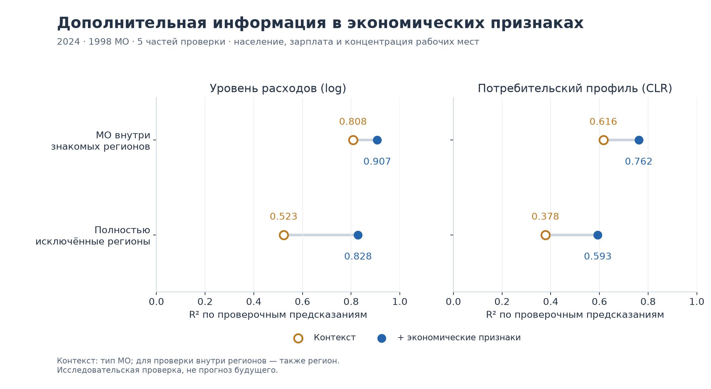
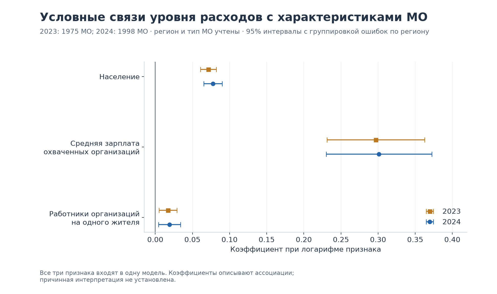
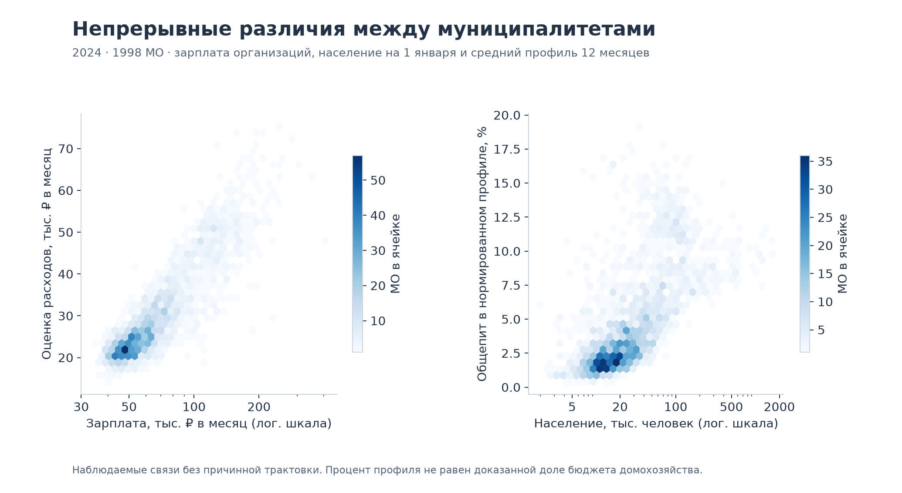
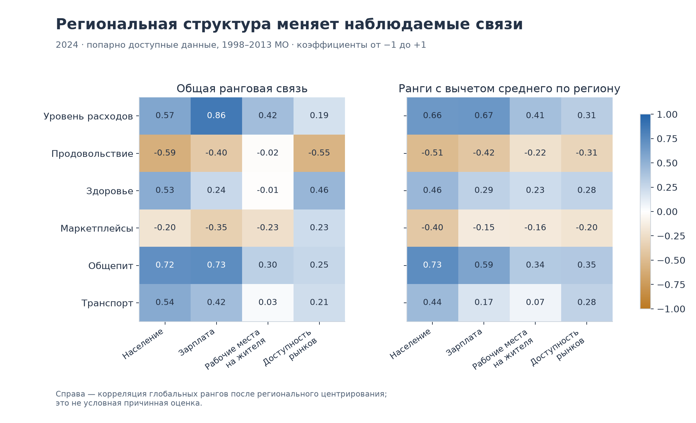
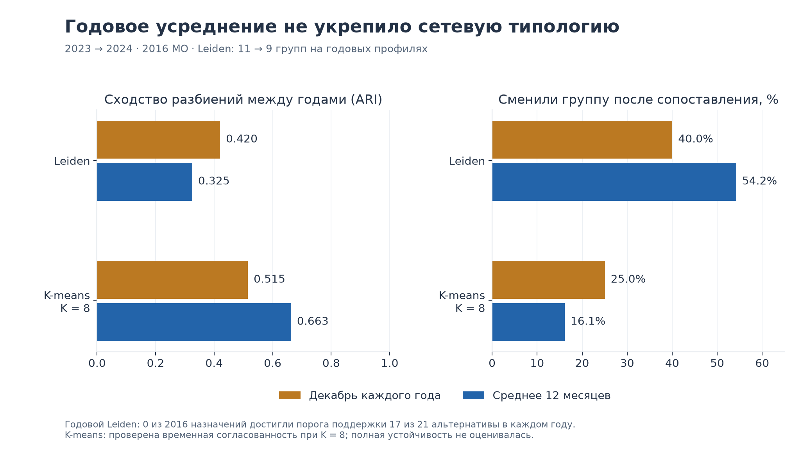

# Что изменилось после обогащения данных

**Кейс 1 СберИндекса · исследовательский анализ от 15 сентября 2026 года · 2016 муниципалитетов, 2023–2024.**

Новые данные дают содержательное объяснение различий потребительских профилей, но пока не подтверждают устойчивую сетевую типологию. Население, зарплата работников организаций и концентрация учитываемых рабочих мест добавляют информацию к региону и типу МО. Этот результат сохраняется при исключении территорий с изменившимся кодом или типом. Однако годовое сглаживание не исправило чувствительность Leiden к настройкам.

Для нашей работы по первому кейсу предлагается центральный тезис: **изучать экономически объяснимые различия и устойчивое сходство муниципалитетов, а доверие к каждой дискретной группе проверять отдельно**. В текущем результате нельзя надёжно назвать муниципальные переходы между группами экономическими структурными изменениями.

Главные численные результаты:

| Вопрос | Новый результат | Что он позволяет утверждать |
|---|---|---|
| Как изменились расходы? | Медианный рост 15,12% номинально и 6,09% после регионального ИПЦ; у 113 МО знак меняется с плюса на минус | Поправка на цены существенно меняет описание динамики |
| Полезно ли обогащение? | В 2024 году R² проверочных предсказаний log расходов внутри регионов растёт 0,808 → 0,907; для CLR-профиля 0,616 → 0,762 | Экономические признаки добавляют описательную информацию |
| Сохраняется ли результат вне знакомых регионов? | R² 0,523 → 0,828 для log расходов; 0,378 → 0,593 для профиля | Связь переносится на исключённые из обучения регионы в этой выборке |
| Имеют ли группы экономическое содержание? | В декабре 2024 Leiden разделяет 56,48% суммы квадратов log зарплаты; региональный перестановочный контроль — медиана 40,16% | Между группами есть внешние ассоциации, превышающие этот контроль |
| Исправляет ли сглаживание неустойчивость? | Годовой Leiden: 0 сильных назначений в каждом году; межгодовой ARI 0,325 против 0,420 для декабрей | Текущая процедура не даёт надёжных жёстких типов |

Все модели ниже используют данные того же года, что и объясняемый показатель. Это **описательная проверка на отложенных объектах**, а не прогноз будущего. Оба года уже изучались; нового нетронутого временного теста здесь нет. Исходное исследование и слои обогащения не изменены.

## 1. Какие данные вошли

Единица основной таблицы — `territory_id × year`: 4032 строки. Исходная полная панель содержит 24 месяца для каждого из 2016 МО. Каждый муниципалитет получает одинаковый вес; результаты не являются средними по жителям России.

| Доступный показатель | 2023, МО | 2024, МО | Смысл и ограничение |
|---|---:|---:|---|
| Потребление: общий показатель и пять категорий | 2016 | 2016 | Опубликованные месячные оценки СберИндекса |
| Принятое население | 1979 | 2013 | На 1 января соответствующего года |
| Среднемесячная зарплата организаций | 2015 | 2000 | Годовой период январь–декабрь; без субъектов малого предпринимательства |
| Среднесписочная численность работников | 2015 | 2000 | Тот же охват организаций; не число занятых жителей |
| Доля городского населения | 1463 | 1485 | Пропуск не равен нулю |
| Доступность рынков | — | 2004 | Статический контекст 2024 года |
| Полная основная модельная выборка | 1975 | 1998 | Все три положительных признака, без исходных календарных флагов экономики |
| Консервативная модельная выборка | 1897 | 1930 | Исключены ID из списка 78 изменившихся: дополнительно 78 наблюдений 2023 и 68 наблюдений 2024 |

Точные маски и причины исключения сохранены в [аудите входов](input_audit/README.md), [таблице покрытия](core_v2/coverage.csv) и [годовой панели](core_v2/annual_panel.csv). Расширенная диагностическая маска аудита допускает четыре ранее разобранных календарных случая 2023 года; основная модель их исключает. Поэтому 1979 в аудите и 1975 в модели — разные, явно заданные выборки.

Соединения проверены как однозначные; строки не размножены. Но совпадение годового кода не доказывает юридическую эквивалентность границ. Даже консервативную выборку нельзя назвать полностью подтверждённой исторической географией. Новые демографические кандидаты и неподтверждённые связи вторичных наборов в расчёты не включены. Площадь на конец 2024 года не делилась на население начала 2024 года для получения якобы одновременной плотности.

Зарплата организаций не равна доходу жителей. Отношение числа работников к населению используется как концентрация учитываемых рабочих мест: оно может превышать единицу, поскольку место работы и проживания различаются. Это не уровень занятости и не величина, которую нужно обрезать до 100%.

## 2. Динамика расходов: после инфляции результат заметно скромнее

Для каждого МО сначала скорректирован каждый месяц на накопленный региональный ИПЦ к декабрю 2022 года, затем рассчитано среднее 12 месяцев. Темп — отношение этих средних за 2024 и 2023 годы минус единица. Все 2016 МО соединены с 73 региональными рядами; муниципальные индексы цен не придумывались.

Медиана номинального роста равна **15,12%**, роста после ИПЦ — **6,09%**. Средние темпы составляют 14,80% и 5,89%. Центральные 50% муниципалитетов имеют рост после ИПЦ от **3,71% до 8,32%**.

Из 2016 МО номинальный рост положителен у 2012, скорректированный — у 1899. У **113** номинальный плюс превращается в минус; ещё четыре имели отрицательный темп в обоих вариантах. Всего отрицательный рост после ИПЦ наблюдается у **117 МО**. Это изменение опубликованной оценки расходов, а не установленное сокращение физического потребления или благосостояния.

На различия муниципалитетов **внутри регионов** приходится 70,72% суммы квадратов разброса скорректированных темпов; на различия региональных средних — 29,28%. Значит, даже с общим региональным дефлятором муниципальный уровень даёт дополнительную описательную детализацию. Это арифметическое разложение, а не причинная доля объяснения.

Есть технически важный результат: единый дефлятор сокращается при нормировании пяти категорий внутри месяца. Поэтому такая поправка **вообще не меняет месячный потребительский профиль**; максимальное численное расхождение — 2,22×10⁻¹⁶. Для анализа относительных цен категорий понадобились бы отдельные сопоставимые дефляторы. Также нельзя заменить помесячный расчёт делением годового среднего расходов на годовой средний ИПЦ: здесь такая замена меняет знак у четырёх МО.

Региональная поправка отражает время, но не паритет цен между регионами: реальный уровень в регионе с дорогими товарами не становится напрямую сопоставимым с другим регионом. [Полные расчёты и ограничения](prices/FINDINGS.md), [таблица по каждому МО](prices/municipal_price_growth.csv).

## 3. Что объясняют население и экономика

Проверены две цели: логарифм среднего месячного общего показателя расходов и пятикомпонентный профиль в CLR-преобразовании. Годовой профиль — среднее 12 уже нормированных месячных профилей. Пять компонент не объявляются точными долями всего бюджета домохозяйства.

В модель добавлены три логарифма: населения, средней зарплаты организаций и отношения числа работников к населению. Базовая модель внутри регионов содержит регион и тип МО; при исключении целых регионов — только тип МО. Используется Ridge с фиксированным `alpha=1`, пять частей проверки. Масштабирование и кодирование категорий обучаются только на тренировочной части. Модели сравниваются на одних и тех же объектах внутри каждого сценария.

| 2024, 1998 МО | Контекст: R² | + три экономических признака: R² | Снижение квадратичной ошибки, 95% интервал |
|---|---:|---:|---:|
| Log расходов, МО внутри регионов | 0,8077 | 0,9073 | 51,82% [45,49%; 57,66%] |
| CLR-профиль, МО внутри регионов | 0,6161 | 0,7616 | 37,90% [32,58%; 42,62%] |
| Log расходов, исключённые регионы | 0,5227 | 0,8284 | 64,04% [55,85%; 70,98%] |
| CLR-профиль, исключённые регионы | 0,3780 | 0,5934 | 34,62% [24,00%; 42,87%] |

Интервалы получены 2000 повторными выборками регионов с сохранёнными проверочными предсказаниями. Они отражают вариацию парных ошибок по регионам, **без повторного обучения моделей**. Это не полная неопределённость всего исследовательского процесса. R² профиля объединяет квадратичные ошибки пяти CLR-координат; его нельзя читать как процент правильно определённых категорий.

В 2023 году результат сходный: внутри регионов R² log расходов растёт 0,8262 → 0,9197, профиля — 0,6190 → 0,7521; на исключённых регионах — 0,5138 → 0,8427 и 0,3421 → 0,5360. После удаления ID из списка 78 изменившихся результат 2024 также сохраняется: полная модель даёт R² **0,9081/0,7604** внутри регионов и **0,8322/0,5954** на исключённых регионах для уровня/профиля соответственно. В 2024 дополнительно удалены 68 МО, остальные десять уже не входили в основную полную выборку.

Эти высокие значения характеризуют восстановление опубликованных оценок СберИндекса. Сам источник использует статистические оценки и демографические корректировки; поэтому внешние связи нельзя считать полностью независимой проверкой по обследованию домохозяйств. Кроме того, муниципалитеты в одной области могут быть пространственно зависимы. Проверка с исключением регионов уменьшает один вид зависимости, но не заменяет пространственную проверку по границам и соседству.

### Условные связи отдельных признаков

Отдельная линейная регрессия учитывает одновременно три экономических признака, регион и тип МО. Интервалы используют кластеризацию ошибок по региону.

| Признак в логарифме | Коэффициент 2024 | 95% интервал |
|---|---:|---:|
| Население | 0,0777 | [0,0651; 0,0902] |
| Средняя зарплата организаций | 0,3013 | [0,2301; 0,3724] |
| Работники организаций / население | 0,0191 | [0,0042; 0,0339] |

Например, различию зарплаты в 10% соответствует около **2,91%** различия расходов при прочих включённых признаках; это ассоциация, а не эффект повышения зарплаты. Коэффициенты 2023 года близки. Но для изменений между годами на 1891 МО со стабильным кодом коэффициент изменения зарплаты заметно меньше: **0,0656 [0,0330; 0,0982]**. Сильная связь уровней не превращается автоматически в такую же сильную связь динамики. Двух лет недостаточно, чтобы отделить причинные эффекты от совместных изменений, погрешностей и состава источника. [Коэффициенты](core_v2/regression_coefficients.csv), [парная выборка изменений](core_v2/stable_code_changes.csv).

Крупные по населению территории чаще имеют больший компонент общепита в нормированном профиле. В 2024 году ранговая корреляция равна **0,716**, а после вычитания среднего глобального ранга соответствующего региона — **0,729**. Для зарплаты и общего уровня расходов эти значения равны **0,855** и **0,666**. Корреляции используют парно доступные данные: 2013 МО для населения и 2000 для зарплаты; это отличается от основной модельной выборки. Таким образом, часть структуры связана с регионом, но заметные различия остаются внутри него. Графики описывают градиенты; сами по себе они не являются тестом отсутствия дискретных классов.

### Доступность рынков полезна прежде всего для состава профиля

Для сравнения добавочного признака базовая экономическая модель заново проверяется на той же полной выборке: 1986 МО для market_access и 1470 для urban в 2024 году. При добавлении market_access ошибка CLR-профиля снижается на **1,26% [0,63%; 1,88%]** внутри регионов и **6,25% [1,42%; 10,73%]** на исключённых регионах. Для log уровня расходов улучшение не подтверждается: точечные изменения отрицательны, интервалы включают ноль. Это результат данной формы модели, а не доказательство бесполезности пространственного контекста.

Доля городского населения даёт небольшую дополнительную информацию о профиле: снижение ошибки **0,96% [0,23%; 1,72%]** внутри регионов и **1,27% [0,30%; 2,37%]** на исключённых регионах в 2024 году. Для уровня расходов её интервалы также включают ноль. Urban и market проверялись отдельно; превосходство их совместного включения здесь не установлено.

Для доступности рынков и компонента маркетплейсов на 2004 МО общая ранговая связь положительна (**+0,225**), а после регионального центрирования отрицательна (**−0,198**). Поэтому рассказ «маркетплейсы растут там, где рынок доступнее» не следует из общей корреляции. Центрирование глобальных рангов — описательный контроль региона, не причинная оценка и не одновременный контроль всех остальных признаков. [Все корреляции](core_v2/correlations.csv), [все сравнения моделей](core_v2/cv_comparisons.csv).

## 4. Экономическое содержание групп есть; устойчивость групп не доказана

Для контекстного разбора использованы замороженные группы декабря каждого года из исходного исследования. Контекст не входил в их геометрию. В декабре 2024 у Leiden 11 групп, у K-means — 8.

| Декабрь 2024 | Межгрупповая доля SS log зарплаты | Медиана регионального контроля | Межгрупповая доля SS log населения | Медиана регионального контроля |
|---|---:|---:|---:|---:|
| Leiden | 56,48% | 40,16% | 52,77% | 12,94% |
| K-means, K=8 | 54,97% | 40,78% | 50,43% | 12,21% |

Контроль перемешивает метки только внутри регионов и сохраняет численность каждого сочетания «регион × группа». Выполнено 499 перестановок. Во всех 12 сравнениях по годам, методам и признакам p=0,002, минимальное разрешение этого расчёта; поправка Holm даёт 0,024. Контроль не устраняет все различия урбанизации, отраслей, локальных цен или пространственную зависимость.

Группы имеют описательные связи с населением и зарплатой сверх такого регионального контроля. Но K-means даёт близкий результат; разное число групп мешает трактовать небольшое преимущество сырой доли SS как преимущество алгоритма. Внутри Leiden остаются **43,52%** общей суммы квадратов log зарплаты. Экономическое название группы не делает её однородной и не доказывает устойчивость назначения каждого МО. [Полный разбор состава групп](cluster_context/README.md).

### Проверка годового сглаживания дала отрицательный результат для Leiden

Средние годовые профили проверены на прежней сетке: две геометрии, три числа соседей, три разрешения и дополнительные seed. Получены 22 разбиения в каждом году, одно первичное и 21 альтернатива. Экономический контекст не добавлялся в расстояния.

| Метод и определение профиля | ARI 2023 → 2024 | Доля смен после сопоставления меток |
|---|---:|---:|
| Leiden, декабрь | 0,4204 | 40,03% |
| Leiden, среднее 12 месяцев | 0,3253 | 54,22% |
| K-means K=8, декабрь | 0,5152 | 25,05% |
| K-means K=8, среднее 12 месяцев | 0,6631 | 16,12% |

У годового Leiden **11 групп в 2023 и 9 в 2024**, но **0 из 2016 назначений в каждом году** достигают принятого порога: сходство состава группы Jaccard ≥0,8 как минимум в 17 из 21 альтернативы. Надёжных смен также ноль. Это означает недостаток поддержки назначений, а не стабильность экономики и не отсутствие изменений. Подобрать после этого удобный порог и объявить его подтверждением нельзя.

Для K-means сглаживание улучшило согласованность во времени при фиксированном K=8. Это полезный базовый результат; полная чувствительность K-means к числу групп и другим решениям здесь не оценивалась. Причина неустойчивости Leiden не установлена этим сравнением. [Протокол, все метки и дополнительная проверка](annual_networks/README.md).

## 5. Шесть территорий для предметного разбора

Из 1998 проверочных предсказаний 2024 года механически выбраны три самых больших положительных и три самых отрицательных остатка основной модели внутри регионов. Названия и предполагаемые экономические истории на выбор не влияли.

| Территория | Опубликованный / модельный уровень | Номинальный рост | Рост после ИПЦ |
|---|---:|---:|---:|
| Нижнеколымский район | 1,627 | 14,35% | 5,61% |
| Верхнеколымский район | 1,518 | 10,23% | 1,83% |
| Куркино, Москва | 1,517 | 15,23% | 5,67% |
| Красноярский район, Астраханская область | 0,612 | 10,08% | 2,14% |
| Светловский ГО, Калининградская область | 0,662 | 3,09% | −6,03% |
| Свободненский район, Амурская область | 0,676 | 7,91% | −0,34% |

Модельный уровень здесь — экспонента предсказанного логарифма, без smearing-коррекции; это не условное арифметическое среднее. Отрицательный остаток не означает падение расходов: Красноярский район имеет положительный рост и до, и после ИПЦ.

Все 18 исходных клеток населения, зарплаты и работников сверены с сохранёнными CSV внутри архивов и их SHA-256; расходы и профили — с исходным Parquet. Это снижает риск ошибки извлечения, но не доказывает одинаковый охват жителей и организаций. Для участников это конкретные случаи проверки состава работодателей, маятниковой занятости, местных цен и географии — **вопросы для исследования**, а не установленные объяснения. [Карточки и происхождение значений](examples/FINDINGS.md), [полный CSV](examples/six_oof_examples_2024.csv).

## 6. Как использовать результат в первом кейсе

Предлагаемый узкий исследовательский результат — атрибутированная сеть потребительского сходства с проверкой устойчивости и экономическим объяснением различий. Новая аналитика даёт ей внешний контекст и показывает границы доверия.

1. **Основной доказанный слой:** непрерывные профили, поправка динамики расходов на цены, внешние связи с населением и экономикой. Их можно показывать вместе с выборкой, годом и неопределённостью.
2. **Группы как исследовательское представление:** показывать состав, соседство и чувствительность, не присваивая территории безусловный экономический тип. K-means K=8 остаётся понятной базой для сравнения.
3. **Следующий методический вопрос:** насколько устойчивы отдельные связи и локальные окрестности МО по расширенному набору допустимых вариантов? В исходном исследовании уже сравнивались соседства двух геометрий при k=20; предложенная проверка расширяет этот разбор. Её новый результат в данном пакете не вычислялся.
4. **Экономическая работа участников:** проверить шесть выбранных случаев по первичным местным источникам и установить, какие различия охвата объясняют остатки. Пространственная работа — проверить границы, соседство и сопоставимость 78 изменившихся ID, затем оценить чувствительность результата к пространственным блокам.

В этом отчёте не сделаны выводы об отраслевой специализации всех МО, причинном влиянии зарплат, экономических шоках или качестве будущего прогноза. Для них нужны другие данные и отдельный дизайн проверки. Текущая работа остаётся в первом кейсе.

## Проверка и воспроизведение

Ключевые числа пересчитаны отдельной реализацией: годовые профили из сырых месяцев, все сохранённые проверочные предсказания, регрессии и региональные интервалы; для годовой сети отдельно восстановлены поддержки и переходы. Шесть окончательных графиков визуально просмотрены. Точные статусы, включая ограничения проверки, собраны в [QA.md](QA.md).

Пакет содержит данные расчётов, конфигурацию, код, промежуточные метки и SHA-256 входов/выходов. [REPRODUCE.md](REPRODUCE.md) описывает команды и восстановление исходников. Оригинальные данные сохраняют атрибуцию [СберИндекса и Росстата](../../DATA_ATTRIBUTION.md); лицензии источников не заменяются лицензией отчёта.
