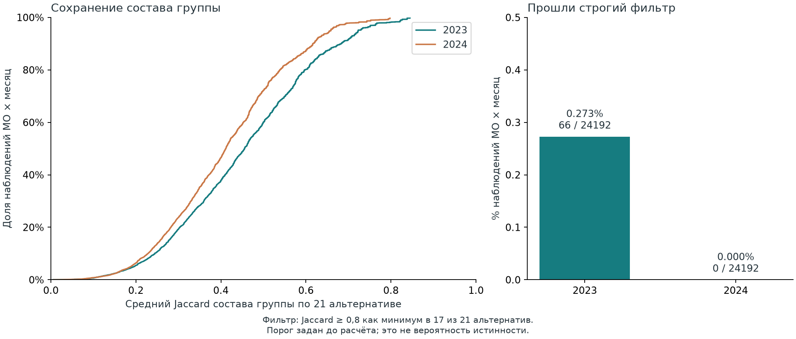

# Насколько устойчивы группы муниципалитетов по потребительским профилям

Первый исследовательский результат по кейсу 1 СберИндекса · 14 сентября 2026 года

**Главный вывод:** в выбранной постановке сеть даёт нетривиальное разбиение, но индивидуальный состав групп чувствителен к методическим решениям. Высокая модульность сама по себе не позволяет считать смену группы экономической трансформацией муниципалитета. Этот вывод повторился на 2024 году после фиксации кода и параметров на результатах 2023 года.

Основной Leiden выделил 9–12 групп в месяцы 2023 года и 9–13 в 2024 году. Строгую проверку состава группы прошли 66 из 24 192 наблюдений «МО × месяц» за 2023 год и 0 из 24 192 за 2024 год. Ни один переход основного Leiden не прошёл заданное парное правило устойчивости. Это результат конкретного набора альтернатив и порогов; он не доказывает отсутствия экономических различий между территориями.

Мой трек — количественная проверка устойчивости динамических сетей, кластеров и переходов. На этом этапе реализован и выполнен весь расчёт первой версии: подготовка данных, сравнение четырёх методов, проверки чувствительности, контрольные разбиения, оценка следующего года и передача результатов. Экономическая интерпретация и пространственная проверка остаются самостоятельными направлениями участников. Их вопросы и входы приведены в [плане совместной работы](../../docs/team_workstreams.md).

## На каких данных получен результат

Использован оригинальный `consumption.parquet` из [архива СберИндекса](https://www.sberbank.com/common/img/uploaded/files/pdf/sberindex/hackathonlicence.zip). Определения показателей взяты из [описания муниципального набора](https://sberindex.ru/ru/research/data-sense-opisanie-nabora-dannikh-khakatona-sberindeksa-po-munitsipalnim-dannim). Показатель представляет модельную оценку средних безналичных расходов жителей; методика не охватывает автоматически всю экономику муниципалитета.

| Проверка | Результат |
|---|---:|
| Исходные строки: территория × месяц × категория | 303 126 |
| Идентификаторы территорий в исходном файле | 2190 |
| Месяцы | январь 2023 — декабрь 2024, 24 месяца |
| Опубликованные категории, включая общий итог | 6 |
| Территории с полной историей | 2016 |
| Территории с неполной историей | 174 |
| Наблюдения МО × месяц в основной панели | 48 384 |
| Назначения в группы для четырёх методов | 193 536 |

Основная панель выбрана по полноте всех 24 месяцев. Это ретроспективный отбор: будущая полнота истории уже известна. Дополнительно на четырёх опорных месяцах каждого года проверен доступный состав территорий. Сравнение с ним оценивает чувствительность к исключению неполной истории, но не доказывает отсутствие смещения охвата.

Ключом служит исходный `territory_id`. Одноимённые муниципалитеты не объединяются по названию. Справочник подписей нужен для чтения примеров; он не подтверждает исторические границы и не участвует в кластеризации.

Для каждой территории и месяца пять значений — продовольствие, здоровье, маркетплейсы, общественное питание, транспорт — разделены на сумму этих пяти значений. Получен вектор `P`, сумма компонент которого равна 1. Это нормированный профиль опубликованных средних показателей. **Его компоненты не объявляются точными долями семейного бюджета:** общий знаменатель категориальных оценок не раскрыт. Показатель «Все категории» оставлен для внешней интерпретации. Арифметический остаток проверен только как вариант признаков.

В такой постановке два МО с разным уровнем расходов, но одинаковым соотношением пяти показателей получают одинаковый профиль. Поэтому выводы относятся к структуре выбранных показателей и не заменяют анализ доходов, отраслей, занятости или объёма местного производства.

## Как устроен эксперимент

Подробные правила записаны в [протоколе](../../docs/experiment_protocol.md), формулы и вырождения метрик — в [справочнике метрик](../../docs/metrics.md). Основной запуск использует сходство Хеллингера, 20 соседей, разрешение Leiden 1,0 и seed 13. Ребро означает сходство профилей; наблюдаемых денежных или товарных потоков в этой сети нет.

Сходство Хеллингера вычисляется как скалярное произведение `sqrt(P)`; ранжирование соседей эквивалентно расстоянию Хеллингера. Вторая геометрия — косинус исходного `P`. Для каждой территории выбираются ближайшие соседи, затем ребро включается, если его выбрал хотя бы один конец. Веса сохраняются. Правила разрешения равенств детерминированы.

Каждый месяц построены четыре разбиения: Leiden на двух геометриях, KMeans с K=8 и KMeans с K, равным числу групп основного Leiden в этом месяце. Последнее сравнение уменьшает влияние разного числа групп, но не уравнивает все свойства алгоритмов. KMeans обучается на `sqrt(P)`, с 20 инициализациями и тем же фиксированным seed.

Внутренние геометрические метрики всех четырёх методов рассчитаны в общем пространстве `sqrt(P)`. Сетевые метрики Leiden-косинус относятся к его косинусной сети; у остальных трёх методов — к сети Хеллингера. Их модульности нельзя трактовать как полностью сопоставимые оценки на одной и той же сети.

Основная проверка устойчивости содержит **21 альтернативу в каждом месяце**. Она сочетает две геометрии, числа соседей 10/20/30 и разрешения 0,75/1/1,25 при seed 13, а также два дополнительных seed 29/47 при основных параметрах обеих геометрий. Само основное разбиение из знаменателя исключено. На январе, апреле, июле и октябре добавлены полный перебор seed, исключение каждой категории, арифметический остаток, изменение состава панели, равный бюджет рёбер и 25 перестановок меток при сохранении размеров групп.

Сначала выполнен 2023 год. Затем создан [evaluation_lock.json](../../configs/evaluation_lock.json), фиксирующий хэши кода, конфигурации и данных; после этого выполнен 2024 год. Ни параметры, ни пороги по результатам 2024 года не менялись. Это проверка описательной процедуры на другом периоде: каждый месяц кластеризуется по собственным данным. Это не прогноз групп и не доказательство работы системы в историческом реальном времени.

## Группы есть, но внутренние метрики отвечают на разные вопросы

В основной сети все 24 месячных графа связны и не имеют изолятов. Минимальный размер группы по месяцам находится в диапазоне 59–147 МО; доля крупнейшей группы — 11,21–17,81%. Заданные ограничения против тривиальных разбиений выполнены, поэтому низкую устойчивость нельзя списать на единственную гигантскую группу или множество одиночных узлов.

Медианы по 12 месяцам проверочного 2024 года:

| Метод | SW ↑ | CH ↑ | AVI ↑ | AVU ↓ | MQ ↑ | S_Dbw: определено месяцев |
|---|---:|---:|---:|---:|---:|---:|
| Leiden, Хеллингер | 0,163 | 785,31 | 0,815 | 0,537 | 0,716 | 2/12 |
| Leiden, косинус | 0,119 | 688,64 | 0,857 | 0,543 | 0,750 | 8/12 |
| KMeans, K=8 | 0,249 | 1079,86 | 0,822 | 0,540 | 0,689 | 8/12 |
| KMeans, K как у основного Leiden | 0,226 | 939,77 | 0,788 | 0,525 | 0,690 | 0/12 |

KMeans даёт более компактные группы в выбранном геометрическом пространстве, а основной Leiden имеет более высокую модульность на общей для этих сравнений сети Хеллингера. Это согласуется с разными целевыми функциями и не определяет победителя по экономическому содержанию. Полные медианы, диапазоны и количества определённых значений обоих лет находятся в [method_metrics.csv](method_metrics.csv).

У **S_Dbw** возникает нулевой знаменатель оценки плотности. За 2023 год метрика отсутствует в 8/12 месяцев основного Leiden, 10/12 косинусного Leiden, 3/12 KMeans с K=8 и 11/12 KMeans с сопоставимым K. За 2024 год эти числа — 10/12, 4/12, 4/12 и 12/12 соответственно. Значения не заменены нулём или epsilon. Медианы рассчитаны на разных наборах месяцев, а у KMeans с сопоставимым K в 2024 году нет ни одного определённого значения. Поэтому единого рейтинга по S_Dbw здесь нет. Для конкурсного отчёта необходимо явно согласовать и объяснить выбранную конвенцию; различия первичных определений описаны в справочнике метрик.

Контроль со случайными метками тоже даёт неоднородный ответ. На всех восьми опорных месяцах основной метод лучше всех 25 перестановок по SW, CH, AVI и MQ, но **хуже всех перестановок по AVU** в принятом направлении «меньше лучше». По S_Dbw проверка ограничена пропусками; в четырёх опорных месяцах 2024 года основное значение не определено.

Следовательно, нельзя писать «все шесть метрик подтвердили качество». Случайные метки — лишь диагностический контроль при фиксированной сети и размерах групп. Их сравнение с оптимизированным разбиением не является полноценным тестом существования экономических сообществ. Формальные p-value по этим 25 перестановкам не рассчитываются; зависимые месяцы не считаются независимыми повторениями.

## От чего зависит состав групп

Для каждого сравнения рассчитан Adjusted Rand Index (ARI), инвариантный к переименованию меток. Значение 1 означает одинаковые разбиения. Низкий ARI не имеет универсального экономического порога, поэтому вместе с агрегатами доступны все сравнения.

| Меняется только один фактор | Сравнений в каждом году | Медиана ARI, 2023 | Медиана ARI, 2024 |
|---|---:|---:|---:|
| Случайный старт Leiden | 24 | 0,634 | 0,575 |
| Хеллингер → косинус | 12 | 0,472 | 0,422 |
| Число соседей | 24 | 0,556 | 0,542 |
| Разрешение Leiden | 24 | 0,643 | 0,585 |
| Смешанные изменения нескольких факторов | 168 | 0,472 | 0,436 |

Смена геометрии даёт наименьшее медианное согласие среди этих четырёх отдельных воздействий в обоих годах. Но даже изменение случайного старта при неизменной сети заметно меняет разбиение. Поэтому весь эффект нельзя объяснить только выбором категорий или числа соседей.

В 2024 году медиана месячных медиан Jaccard наборов соседей между двумя геометриями равна 0,518, диапазон — 0,457–0,545. Меняется уже локальное окружение территорий до кластеризации. Контроль равного числа рёбер, исключение признаков и расширение панели сохранены отдельно в [robustness.csv](robustness.csv); они не смешаны с 21 альтернативой при расчёте индивидуальной поддержки. Их диапазоны описывают результаты выбранных вариантов, а не доверительные интервалы.

Исключение категории меняет сам вопрос о сходстве. Такая чувствительность не является автоматически ошибкой метода: часть различий может отражать действительное содержание признака. Для интерпретации нужен ответ экономического трека о том, какие признаки допустимы и какой смысл теряется при их удалении.

## Как измерена поддержка отдельного назначения

Для муниципалитета сравнивается множество остальных МО в его группе основного и альтернативного разбиений. Jaccard равен размеру пересечения этих множеств, делённому на размер объединения. Так смена номера метки не создаёт ложную неустойчивость.

Альтернатива поддерживает назначение, если Jaccard ≥ 0,8. Назначение проходит итоговый фильтр, если его поддерживают не менее 80% из 21 альтернативы, то есть минимум 17. Оба порога заданы до расчёта. Это строгий операционный фильтр, а не вероятность правильности или оценка доли настоящих экономических типов. Перебор вариантов также не является случайной выборкой из всех возможных методов.

| Период | Прошли фильтр | Знаменатель МО × месяц | Доля | Медиана среднего Jaccard по альтернативам |
|---|---:|---:|---:|---:|
| 2023 | 66 | 24 192 | 0,273% | 0,455 |
| 2024 | 0 | 24 192 | 0,000% | 0,411 |

Единица счёта здесь — наблюдение «МО × месяц». Все 66 прошедших фильтр наблюдений относятся к 66 разным муниципалитетам в августе 2023 года; в остальных месяцах таких наблюдений нет. Это не подтверждение устойчивости этих МО на протяжении года. Непрерывная оценка Jaccard помогает увидеть степень расхождения и не сводить всё к прохождению жёсткого порога. Нулевой итог 2024 года показывает ограниченность выбранной типологии для уверенной индивидуальной маркировки; он не исключает более грубые устойчивые группы или полезный анализ непрерывных профилей.

## Переходы: почему сырую смену метки нельзя назвать шоком

Для каждой пары месяцев группы сопоставлены по максимальному пересечению на общих территориях. Равные по качеству сопоставления разрешаются детерминированно. Это техническое соответствие для пары; оно не устанавливает единственную истинную историю группы. Таблица [flows.csv](flows.csv) сохраняет все исходные потоки, чтобы не скрывать разделения и слияния за сопоставлением один к одному.

Переход считается устойчивым, только если как минимум 17 одних и тех же альтернатив одновременно достигают Jaccard ≥ 0,8 к основной группе в обоих концах пары и воспроизводят решение о смене группы. Высокая поддержка каждого конца по разным наборам альтернатив недостаточна. Проверены 23 соседние пары и 12 пар с лагом 12 месяцев; декабрь 2023 → январь 2024 включён.

| Основной Leiden | Смена после сопоставления | Все пары «МО × месяцы» | Доля | Прошли парный фильтр |
|---|---:|---:|---:|---:|
| Соседние месяцы | 18 008 | 46 368 | 38,84% | 0 |
| Один месяц разных лет | 11 018 | 24 192 | 45,54% | 0 |

Дополнительная диагностика сохранённых `variant_evidence.npz` после просмотра результатов 2024 года показала: максимальная совместная поддержка обоих концов среди всех проверенных пар равна 14/21, что меньше необходимых 17/21. Поэтому нулевой результат парного фильтра уже следует из недостаточной поддержки концов, ещё до проверки воспроизведения смены группы. Он не является самостоятельным свидетельством отсутствия изменений экономики. Это диагностика полученных результатов; процедура и пороги не менялись.

Средний ARI соседних месяцев равен 0,445 для основного Leiden, 0,422 для косинусного, 0,574 для KMeans с K=8 и 0,497 для KMeans с сопоставимым K. Для пар год к году — 0,357, 0,332, 0,473 и 0,372 соответственно. По этим данным KMeans в среднем стабильнее во времени, в том числе при сопоставимом K. Это описательное сравнение на одной панели, без независимого доказательства экономической правильности.

У методов сравнения `robust_switch` не оценён: в их строках пропуск, а не ноль. Фильтр с 21 альтернативой построен относительно основного Leiden. Его отрицательный результат нельзя переносить на методы, для которых такая проверка не проводилась.

Для первого кейса практическое следствие таково: сначала следует объяснить устойчивые различия самих профилей и пределы их дискретизации. Искать новостную причину для каждой сырой смены группы на этом этапе было бы преждевременно. По данным расчёта у нас пока нет подтверждённого списка экономических трансформаций муниципалитетов.

## Что передано участникам

**Michelin5 / @yeyeyoyo — экономическая интерпретация и смысл измерений.** [Подробный бриф](../../docs/brief_economic_interpretation.md). Предлагаю проверить общие знаменатели категорий, отделить уровень расходов от структуры, сформулировать допустимые названия профилей и проверить несколько примеров с альтернативными объяснениями. Главный вопрос после этого расчёта: какие устойчивые экономические различия остаются в непрерывных профилях, когда жёсткая принадлежность к группам ненадёжна? Не требуется обязательно находить объяснение каждому переходу.

**appu-frog / @Card_1905 — пространственная проверка и доступность рынков.** [Подробный бриф](../../docs/brief_spatial_validation.md). Предлагаю проверить соединение территориальных кодов и версий границ, сопоставить профили и группы с географией и доступностью рынков и оценить роль административных изменений. Главный вопрос: какие пространственные связи выдерживают смену разумных вариантов классификации? Статические данные 2024 года не выдаются за помесячные измерения 2023 года.

Это предложения направлений; принятие задач участниками не предполагается. Новые проверки, придуманные после просмотра результатов 2024 года, нужно обозначать как исследовательские. Объединять их с ранее зафиксированной проверкой без такого различия нельзя.

| Файл в этой папке | Как использовать |
|---|---|
| `assignments.parquet` | МО × месяц × метод; исходная метка и пять нормированных признаков |
| `cluster_profiles.csv` | Размер группы и медиана, 25-й и 75-й процентили каждого признака |
| `membership_agreement.parquet` | Поддержка и средний Jaccard каждого назначения основного метода |
| `monthly_support.csv` | Месячные числители, знаменатели и сводки поддержки |
| `transitions.parquet` | Пара месяцев × МО × метод, согласованные метки, изменение профиля и парная устойчивость |
| `flows.csv`, `temporal_summary.csv` | Все потоки между исходными группами и сводки календарных пар |
| `method_metrics.csv`, `robustness_summary.csv` | Агрегаты с числом определённых значений |
| `robustness.csv`, `null_metrics.csv` | Отдельные диагностические сравнения и контрольные перестановки |
| `variant_evidence.npz`, `variant_keys.json` | Упорядоченные парные альтернативы для перепроверки устойчивости |
| `summary.json`, `report_manifest.json` | Размеры, источники, хэши и происхождение числового пакета |

Метки локальны для месяца и метода; одинаковый номер в разных месяцах ничего сам по себе не означает. Медианы компонент профиля группы по отдельности не обязаны суммироваться ровно в 1. Не усредняйте их как готовую композицию без дополнительного правила.

## Что подтверждено и что пока нельзя утверждать

| Утверждение | Статус и основание |
|---|---|
| Выбранная процедура создаёт нетривиальные группы | Подтверждено на 24 месяцах; размеры и связность проверены |
| Принадлежность чувствительна к методическим решениям | Подтверждено заданными альтернативами на обоих годах |
| KMeans в среднем стабильнее во времени в этом сравнении | Подтверждено описательными ARI, включая контроль сопоставимого K |
| Найдены устойчивые экономические типы территорий | Не установлено; индивидуальная поддержка мала и экономическая проверка не завершена |
| Сырые переходы означают экономические шоки | Не установлено; ни один не прошёл наш парный фильтр |
| Низкая устойчивость означает отсутствие экономической структуры | Из этих результатов не следует |
| Метод предсказывает будущее | Не проверялось; прогноз не входит в этот трек |
| Географические и институциональные причины групп известны | Не проверено; отдельные задачи участников |

Ограничения также включают модельную природу исходных оценок, нераскрытые знаменатели категорий, короткую историю из 24 месяцев, ретроспективный состав панели, отсутствие исторических версий опубликованных данных и независимых меток «истинных экономических типов». Проверенные способы сходства и параметры не исчерпывают все разумные варианты.

Ближайший узкий вопрос моего трека для следующей версии: можно ли выделить повторяемое ядро состава групп, сохранив прозрачное правило отказа от назначения остальных МО? Ответ требует отдельного заранее описанного эксперимента. Пороги этой версии не будут ослаблены задним числом для получения удобного числа переходов; её результаты сохраняются как самостоятельная проверка.

## Воспроизведение и проверка

Запуски: `development-20260914-v1` и `evaluation-20260914-v1`. Первый завершён за 73,3 с, второй за 70,8 с на текущем Windows-окружении при ограничении вычислительных библиотек одним потоком. Эти времена не являются сравнением производительности алгоритмов и могут отличаться на другой машине.

Основной код, параметры, версии зависимостей, контрольные суммы источника и сохранённых результатов включены в репозиторий. Команды приведены в [README](../../README.md); [QA.md](QA.md) фиксирует проверки и их границы. Числовой пакет объединён из сохранённых разбиений без повторного обучения.

Статус передачи: **готово для независимого воспроизведения**. Реальные запуски, отдельная проверка таблиц и синтетические сквозные тесты выполнены в текущем окружении. Полное независимое воспроизведение другим участником на чистой машине ещё не выполнено.

Преобразованные данные используют исходную атрибуцию и условия CC BY-SA 4.0; подробности в [DATA_ATTRIBUTION.md](../../DATA_ATTRIBUTION.md). Требования первого кейса и определения критериев проверялись по [положению конкурса](https://sber.ru/common/assets/sber/sberindex_polozhenie_o_konkurse.pdf). Этот отчёт описывает исследование команды, не позицию организаторов.
