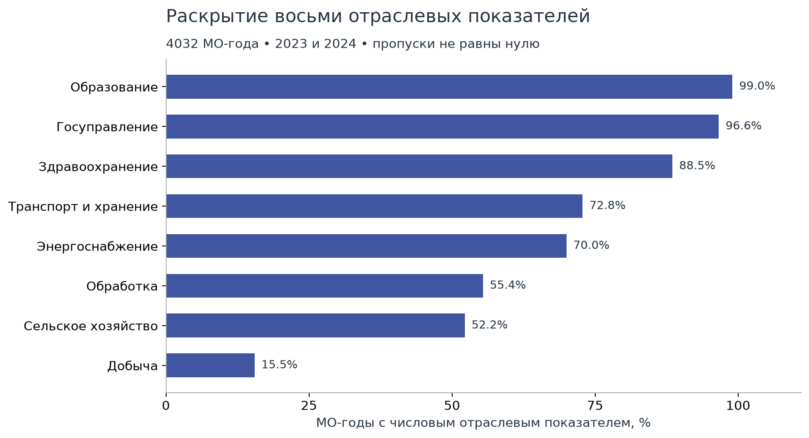
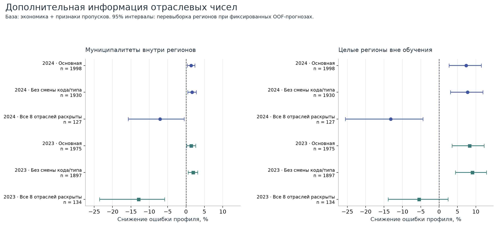
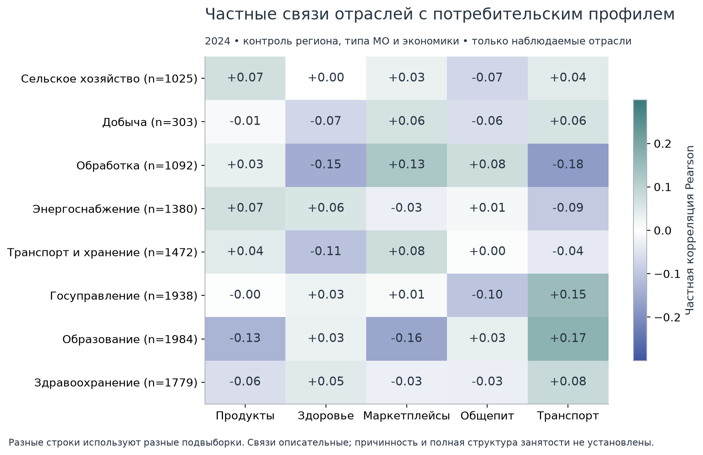
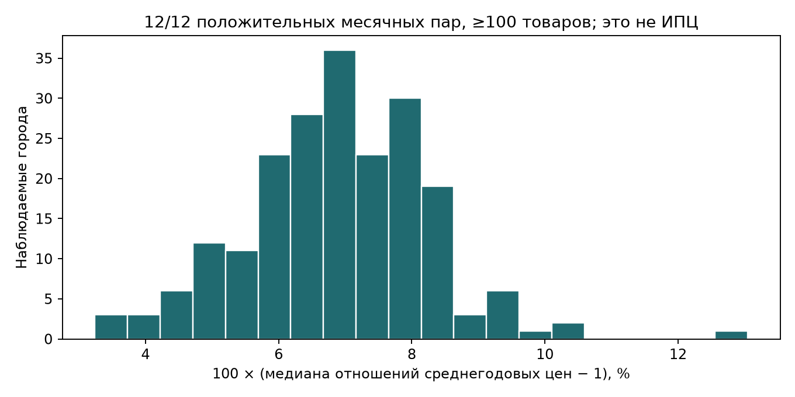

# Что новые данные добавляют к муниципальным профилям

Первый кейс СберИндекса. Анализ данных за 2023 и 2024 годы, 15 сентября 2026 года.

## Основные результаты

Отраслевые показатели дают небольшую дополнительную информацию о составе потребительского профиля: ошибка уменьшается примерно на 1,4% внутри регионов и на 7–8% при проверке на целых регионах вне обучения. Сравнение уже учитывает сам факт отсутствия отраслевых чисел.

На небольшой выборке с полными восемью отраслевыми показателями результат ухудшается. Поэтому отрасли стоит сохранить как дополнительные атрибуты для интерпретации и дальнейшей проверки; универсальная польза и надёжная типология муниципальных экономик пока не установлены.

Городские цены помогают интерпретировать номинальный уровень расходов на узкой городской подвыборке. Убедительной отдельной связи с составом пятикомпонентного профиля не обнаружено. Новые данные не устраняют прежние ограничения по географии и устойчивости кластеров.

## Как читать результаты

Основная панель содержит 2016 муниципалитетов за два года. Из неё по прежним правилам качества в модели входят 1975 МО за 2023 год и 1998 за 2024-й. Каждый МО имеет одинаковый вес. Потребительский профиль — среднее 12 месячных нормированных значений пяти категорий Сбера. Эти значения характеризуют соотношения опубликованных показателей и не являются полной структурой бюджета домохозяйства.

Базовые характеристики: регион и тип МО, население, зарплата организаций и число учтённых работников на жителя. В проверке целых регионов региональные признаки исключены. Затем добавлены восемь индикаторов пропусков и восемь отношений отраслевых работников к официальному общему итогу. Исходная статистика исключает малое предпринимательство; рабочие места в МО и занятые жители различаются.

Все варианты сравниваются на одинаковых строках и пяти разбиениях. Медианы для модельного заполнения пропусков, масштабы и категории оцениваются только на обучающей части. Положительное снижение ошибки означает улучшение; R² показывает долю вариации пяти CLR-координат, объяснённую вне обучающей выборки. Это ретроспективное описание, не прогноз будущего.

## Раскрытие отраслей сильно различается

Образование наблюдается в 99,0% из 4032 МО-лет, госуправление в 96,6%, добыча в 15,5%. В 174 МО-годах добыча вообще не предлагается в форме источника. Такой пропуск не означает нулевую добычу. Восемь отраслей выбраны до просмотра модельных результатов: сельское хозяйство, добыча, обработка, энергоснабжение, транспорт, госуправление, образование и здравоохранение.

Столбцы показывают наличие числовой доли, а не размер отрасли. Для интерпретации сети нужно хранить показатели раскрытия вместе с числовыми атрибутами. Отраслевые числа не перенормируются до 100%; в 88 МО-годах арифметическая сумма раскрытых чисел слегка выше официального итога, причина не установлена.

## Прирост есть, но его величина зависит от проверки

После контроля пропусков отраслевые числа снижают ошибку профиля на 1,40% в 2023 году и на 1,38% в 2024-м при проверке муниципалитетов внутри регионов. При удержании целых регионов снижение составляет 8,27% и 7,34%. В этих четырёх сравнениях интервалы перевыборки регионов остаются выше нуля. Это дополнительная информация сверх населения, зарплаты и концентрации рабочих мест, а не причинный эффект отраслей.

Таблица показывает базу с контролем пропусков и вариант с числовыми отраслевыми долями. Проценты относятся к уменьшению квадратичной ошибки профиля, а не к росту потребления или точности в процентах.

| Год | Проверка | МО | R² базы | R² с отраслями | Снижение ошибки, % | 95% интервал, % |
| --- | --- | --- | --- | --- | --- | --- |
| 2023 | Внутри регионов | 1975 | 0.7569 | 0.7603 | 1.4 | [0.17; 2.61] |
| 2023 | Новые регионы | 1975 | 0.5341 | 0.5726 | 8.27 | [3.52; 12.25] |
| 2024 | Внутри регионов | 1998 | 0.7654 | 0.7686 | 1.38 | [0.36; 2.43] |
| 2024 | Новые регионы | 1998 | 0.593 | 0.6228 | 7.34 | [2.71; 11.51] |

## Полное раскрытие пока не подтверждает улучшение

После исключения территорий со сменой кода или типа прирост сохраняется: 1,92% и 1,64% внутри регионов, 9,06% и 7,72% при удержании целых регионов за 2023 и 2024 годы соответственно. При дополнительных разбиениях внутри регионов прирост основной выборки составляет 1,40–1,65% в 2023-м и 1,38–1,87% в 2024-м.

Но одновременно все восемь отраслей раскрыты только у 134 и 127 МО основной выборки. Здесь ошибка внутри регионов увеличивается на 12,91% и 7,08%; при удержании регионов — на 5,49% и 13,18%. Это другая, маленькая и отобранная по раскрытию выборка. По этому опыту нельзя отделить влияние её состава от размера обучения и ограничений модели. Полный отраслевой профиль пока не получил универсального подтверждения.

На графике показаны все три выборки, включая неудачный результат. Нулевая линия отделяет улучшение от ухудшения. Интервалы получены из 2000 парных перевыборок регионов по фиксированным OOF-ошибкам; они не включают неопределённость повторного обучения всего процесса.

| Год | Выборка | Проверка | МО | Снижение ошибки, % | 95% интервал, % |
| --- | --- | --- | --- | --- | --- |
| 2023 | Основная | Внутри регионов | 1975 | 1.4 | [0.17; 2.61] |
| 2023 | Основная | Новые регионы | 1975 | 8.27 | [3.52; 12.25] |
| 2023 | Без смены кода | Внутри регионов | 1897 | 1.92 | [0.57; 3.15] |
| 2023 | Без смены кода | Новые регионы | 1897 | 9.06 | [4.42; 12.88] |
| 2023 | Полные 8 отраслей | Внутри регионов | 134 | -12.91 | [-23.56; -5.82] |
| 2023 | Полные 8 отраслей | Новые регионы | 134 | -5.49 | [-13.86; 2.45] |
| 2024 | Основная | Внутри регионов | 1998 | 1.38 | [0.36; 2.43] |
| 2024 | Основная | Новые регионы | 1998 | 7.34 | [2.71; 11.51] |
| 2024 | Без смены кода | Внутри регионов | 1930 | 1.64 | [0.47; 2.79] |
| 2024 | Без смены кода | Новые регионы | 1930 | 7.72 | [3.10; 11.92] |
| 2024 | Полные 8 отраслей | Внутри регионов | 127 | -7.08 | [-15.74; -0.52] |
| 2024 | Полные 8 отраслей | Новые регионы | 127 | -13.18 | [-25.50; -4.42] |

Одна заранее заданная перестановка наблюдаемых отраслевых значений внутри регионов при сохранении пропусков даёт для профиля −0,53% и −0,22% внутри регионов, +1,29% и +0,77% при удержании регионов. Во всех четырёх случаях интервалы включают ноль. Это диагностический контроль, а не перестановочный p-value.

Для общего номинального уровня расходов отрасли не дают столь же устойчивого улучшения: −0,20% и −0,11% внутри регионов, +2,49% и +2,63% при удержании регионов. Все четыре интервала включают ноль. Основная обнаруженная польза относится к составу профиля.

## Отрасли уточняют непрерывные различия между территориями

Например, в 2024 году большая наблюдаемая доля работников образования связана с более высокой транспортной координатой профиля (+0,17) и более низкой координатой маркетплейсов (−0,16) после учёта региона, типа МО и базовых экономических показателей. Для обработки наблюдаются связи +0,13 с маркетплейсами и −0,18 с транспортом. Это частные корреляции, а не эффекты увеличения занятости в отрасли. Для разных отраслей доступны разные наборы муниципалитетов.

Полная таблица содержит все 96 связей: восемь отраслей, шесть исходов, два года. Выбор примеров в тексте описательный; подтверждающих тестов отдельных отраслевых гипотез здесь нет. Эти результаты поддерживают интерпретацию непрерывного сходства профилей. Они не доказывают существование устойчивых дискретных типов муниципальной экономики.

## Цены связаны с уровнем расходов на городской подвыборке

Годовой индекс стоимости жизни доступен для 215 МО в 2023 году и 214 в 2024-м, около 10,6% исходной панели. В 2024 году медианное население выбранных территорий — 106466 человек против 20981 вне этой подвыборки; городские округа составляют 75,2% выбранных МО против 21,5% всей панели. Это не представительная выборка российских муниципалитетов.

После ограничения полными базовыми признаками остаются 207 и 212 МО. Частная корреляция логарифмов ИСЖ и расходов составляет 0,406 и 0,349. Интервалы из 999 перевыборок регионов с повторной оценкой контрольных зависимостей выше нуля. При этом интервалы для каждой из пяти координат состава профиля включают ноль в обоих годах. Это отсутствие убедительного сигнала в данной выборке, не доказательство отсутствия связи вообще.

Таблица сопоставляет исходную и скорректированную связь. Регион, тип МО и экономика снимают большую часть вариации городского ИСЖ; оставшиеся различия не позволяют трактовать коэффициенты причинно. Цена наблюдается в городе, связь с родительским МО не устанавливает равенство их границ.

| Год | МО | Регионов | Исходная r | Частная r | 95% интервал частной r |
| --- | --- | --- | --- | --- | --- |
| 2023 | 207 | 67 | 0.805 | 0.406 | [0.197; 0.546] |
| 2024 | 212 | 70 | 0.754 | 0.349 | [0.154; 0.522] |

## Сопоставимые товарные цены дают полезную диагностику

Строго сопоставлены 1238346 положительных месячных пар одинаковых товаров и единиц за 2023 и 2024 годы. Полные 12 пар есть у 102759 сочетаний город–товар. В 207 городах остаётся от 317 до 564 таких товаров; медиана городских медиан отношений средних годовых цен равна 1.06918, или +6.92%. У всех товаров здесь одинаковый вес, а наборы между городами различаются. Это описательная характеристика наблюдаемых цен, не ИПЦ, не муниципальная инфляция и не дефлятор пяти категорий Сбера.

Общий набор из 377 товаров полностью наблюдается в 90 городах; для него медиана составляет 1,07000. На тех же 90 городах с их собственными полными наборами она равна 1,07241. Близость этого контрольного расчёта не исправляет географическую и товарную селекцию. Обнаружены 290 городских товарных отношений ниже 0,5 или выше 2. Они сохранены для проверки исходных ячеек; причины экстремальных значений не установлены.

На графике каждый город представлен одной медианой. Источники исключений сохранены: неоднозначный код Вышнего Волочка в январе 2023 года, временно не подтверждённые связи городов, нулевые цены и отсутствующие месячные товарные позиции не восстанавливались.

## Шесть примеров получили более конкретный отраслевой контекст

Все шесть территорий были выбраны по крайним остаткам прежней модели, поэтому не являются независимой проверочной выборкой. Ниже указана крупнейшая среди раскрытых отраслей в 2024 году. Во всех шести она совпадает с крупнейшей раскрытой отраслью 2023 года. Доля делится на официальный общий итог работников организаций, не на сумму доступных отраслей.

| Муниципалитет | Максимум среди раскрытых | Работники 2024 | Общий итог 2024 | Доля 2023 | Доля 2024 | Раскрыто отраслей 2024 |
| --- | --- | --- | --- | --- | --- | --- |
| Верхнеколымский район | Транспорт и хранение | 440 | 1446 | 30.39% | 30.43% | 8 |
| Нижнеколымский район | Образование | 290 | 1101 | 25.49% | 26.34% | 8 |
| Свободненский район | Энергоснабжение | 2937 | 8927 | 40.56% | 32.90% | 12 |
| Красноярский район, Астраханская область | Обработка | 5670 | 11862 | 45.09% | 47.80% | 16 |
| Светловский округ | Обработка | 2864 | 6455 | 31.93% | 44.37% | 11 |
| Куркино | Образование | 1184 | 3349 | 31.51% | 35.35% | 7 |

В Светловском округе опубликованные работники обработки выросли с 1723 до 2864, а её доля в общем итоге с 31,93% до 44,37%. В Свободненском районе работники энергоснабжения выросли с 2549 до 2937, но доля снизилась с 40,56% до 32,90% при росте общего итога. В Куркине работники образования сократились с 1201 до 1184, а доля выросла с 31,51% до 35,35%. Последний пример показывает, почему рост доли сам по себе не доказывает расширение отрасли.

Такие наблюдения дают конкретные вопросы для проверки организаций и охвата источника. Они не устанавливают причину потребительского остатка, инвестиционный проект, миграцию или экономический шок. Перепись 2021 года пока не имеет принятого географического соединения с нашей панелью 2023/2024, поэтому в эти расчёты не включена.

Из шести примеров принятый городской ценовой контекст есть только у Верхнеколымского района: для пгт Зырянка ИСЖ равен 1,44 в 2023 и 2024 годах. Это стоимость сопоставляемой годовой корзины относительно России в том же году, а не цена для всего района. Равенство индекса между годами не означает неизменность цен. Оно даёт контекст высокого номинального уровня расходов, но не устанавливает причину отклонения от модели. Для остальных пяти примеров подстановка ближайшего города не выполнялась.

## Что использовать в работе над первым кейсом

1. Сохранить отраслевые доли и признаки раскрытия как отдельный слой атрибутов муниципалитетов. Основную сеть сходства потребительских профилей пока не менять; новые данные не содержат наблюдаемых межмуниципальных экономических потоков.
2. В итоговой работе показать и прирост на основной панели, и ухудшение на полной отраслевой подвыборке. Следующий узкий эксперимент должен разделить влияние размера выборки, её состава и редких отраслевых признаков, с новым заранее зафиксированным протоколом.
3. Для экономического разбора приоритетны Светловский округ, Свободненский район и Куркино: проверить изменения числителей, общего итога и состава учтённых организаций. Названия предприятий и причины изменений потребуют первичных подтверждений.
4. Использовать цены как городской контекст номинальных уровней и для проверки подозрительных товарных рядов. Для дефлятора нужны обоснованные веса и соответствие товарных категорий, которых данный расчёт не устанавливает.

## Что остаётся открытым

Одинаковый муниципальный код на 1 января не доказывает неизменность границ и состава организаций за весь год. Исключение 78 сменивших код или тип МО остаётся проверкой чувствительности, а не сертификатом географической эквивалентности остальных.

Пропуски отраслей могут зависеть от структуры экономики, формы публикации и охвата организаций. Индикаторы пропусков уменьшают смешение этих факторов в сравнении моделей, но не устраняют селекцию. Все данные ретроспективны, оба года уже изучены, модели и отдельные примеры не дают причинных выводов. Неопределённость границ, источников и доступности данных не покрывается статистическими интервалами.

Ограничения прежних дискретных кластеров сохраняются. Новые результаты усиливают проверяемую часть исследования о непрерывных различиях муниципальных профилей и уточняют, какие экономические атрибуты пригодны для их интерпретации.

## Источники и воспроизведение

Исходный пакет второго раунда зафиксирован в коммите `ac535334432bca4f99c30cd430f5b5cf4bd0811a` репозитория [municipal-economic-profiles](https://github.com/sberindex-hackathon-2026/municipal-economic-profiles). [Полный анализ и таблицы](https://github.com/sberindex-hackathon-2026/municipal-economic-profiles/tree/main/reports/round2_analysis), [протокол](https://github.com/sberindex-hackathon-2026/municipal-economic-profiles/blob/main/configs/round2_analysis_v1.json), [независимая проверка](https://github.com/sberindex-hackathon-2026/municipal-economic-profiles/blob/main/reports/round2_analysis/independent_review.md), [команды воспроизведения](https://github.com/sberindex-hackathon-2026/municipal-economic-profiles/blob/main/reports/round2_analysis/REPRODUCE.md). Отраслевой и ценовой блоки содержат собственные описания, QA, исходные ссылки и хеши.
