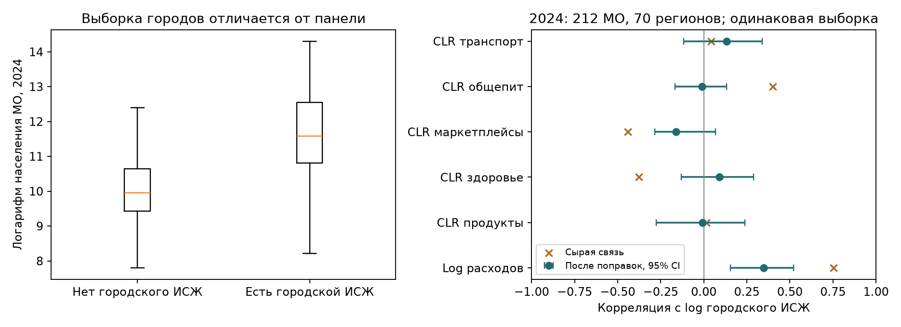

# Что добавили локальные цены

**Городской ИСЖ связан с общим уровнем расходов даже после учёта экономических признаков и региона. Для состава пятикомпонентного профиля устойчивой связи в отдельных координатных проверках не установлено.** Сопоставление месячных цен даёт отдельный описательный результат: медиана городских медиан отношений среднегодовых цен одинаковых товаров равна **1,06918**, или **+6,92%**. Это не официальный ИПЦ, не муниципальная инфляция и не дефлятор категорий СберИндекса.

Все расчёты находятся в [canonical](canonical/). Использованы только ранее принятые связи `bridge_v2` и `monthly_v3`; источники, прежняя кластеризация и модельные результаты не изменены. Область применения каждой связи — `city_context_only`: ценовой контекст наблюдаемого города внутри МО. Его нельзя переносить на весь округ или район. [Протокол](canonical/protocol.json) зафиксирован перед расчётом результатов.

## 1. Кого мы действительно наблюдаем

Городской ИСЖ доступен для **215 из 2016 МО в 2023 году и 214 в 2024 году** — 10,66% и 10,62% панели. Эти города охватывают 69 и 70 регионов из 73. Полные экономические признаки есть у 207 и 212 наблюдений; именно эти выборки используются для основной проверки связей. При исключении МО из прежнего списка изменившихся кодов/типов остаются 205 и 210.

Выборка сильно смещена в сторону крупных городских МО. В 2024 году:

| Признак | Есть городской ИСЖ | Нет принятого городского ИСЖ |
|---|---:|---:|
| Медианное население МО | 106 466; 213 чисел | 20 981; 1800 чисел |
| Медианная зарплата работников учитываемых организаций, руб. | 76 212,25; 212 чисел | 60 286,55; 1788 чисел |
| Медианный общий показатель расходов СберИндекса, руб. | 34 471,83; 214 чисел | 25 735,42; 1802 числа |

Городские округа составляют **75,23%** ценовой выборки 2024 года, но **21,48%** всей панели. Внутригородские муниципалитеты федеральных городов в принятой выборке отсутствуют: единый индекс Москвы или Петербурга на них не размножался. Стандартизованная разность средних log населения между выбранными и остальными МО равна **1,57**, для log расходов — **0,74**. Эти различия описывают отбор, а не эффект наличия ценовых наблюдений. Подробности и отдельные знаменатели: [числовые характеристики](canonical/selection_numeric.csv), [типы и регионы](canonical/selection_categories.csv), [SMD](canonical/selection_smd.csv), [полнота](canonical/coverage.csv).

## 2. ИСЖ и расходы: связь уровня сохраняется, связь состава неопределённа

Медиана ИСЖ в принятой выборке равна **0,96 в оба года**; ниже российского уровня 1 находятся 140 из 215 и 138 из 214 наблюдений. Между годами есть 210 общих принятых МО; у 208 не меняется точный городской ОКТМО. На этих 208 городах ранговая корреляция уровней ИСЖ равна **0,9887**, медиана отношения 2024/2023 — **1,0**. Последнее не означает нулевую инфляцию: ИСЖ сравнивает город с меняющимся общероссийским уровнем и использует ежегодно обновляемые веса. [Уровни](canonical/iszh_levels.csv), [парные данные](canonical/paired_iszh.csv).

Предиктор — log городского ИСЖ. Исходы — log среднего месячного общего показателя расходов за год и пять CLR-координат годового профиля. Годовой профиль в исходном core — среднее 12 месячных нормированных профилей; его CLR вычисляется после этого усреднения. Каждая сырая и скорректированная корреляция сравнивается на **одних и тех же полных наблюдениях** своего года.

Поправки включают log населения, log зарплаты, log отношения работников к населению, тип МО и фиксированные эффекты региона. Из предиктора и каждого исхода удалены линейные компоненты этих признаков. Интервалы получены **999 повторными выборками целых регионов с возвращением, seed=13**, с повторной оценкой поправок. Это маргинальные описательные 95% интервалы, без поправки на множественные проверки; годы не являются независимыми репликациями.

| Связь с log расходов | 2023 | 2024 |
|---|---:|---:|
| Полная выборка | 207 МО, 67 регионов | 212 МО, 70 регионов |
| Сырая корреляция | 0,805 | 0,754 |
| Частная корреляция | **0,406 [0,198; 0,547]** | **0,349 [0,154; 0,523]** |
| Коэффициент log ИСЖ после поправок | 0,679 [0,287; 1,099] | 0,631 [0,270; 1,086] |
| Частная корреляция, стабильные коды | 0,422 [0,234; 0,550] | 0,369 [0,171; 0,531] |

После поправок остаётся только **8,28% и 7,88%** исходной дисперсии log ИСЖ. Поэтому условная связь опирается на сравнительно небольшой остаток различий внутри регионального и экономического контекста. В полных выборках 11 и 12 регионов представлены одним городом: такие регионы не дают вариации после удаления регионального среднего. Это не доказательство причинного влияния цен на расходы и не независимая проверка исходных оценок СберИндекса обследованием домохозяйств. Кроме того, [методология ИСЖ, приказ 440](https://rosstat.gov.ru/storage/mediabank/meta_ipc_prikaz_440.pdf), страница 13, допускает замену отсутствующих городских цен региональными, затем окружными или российскими. Не все составляющие индекса являются самостоятельными местными наблюдениями.

Для состава профиля картина другая:

| CLR-координата, 2024 | Сырая корреляция | Частная корреляция, 95% интервал |
|---|---:|---:|
| Продукты | 0,014 | −0,007 [−0,275; 0,239] |
| Здоровье | −0,377 | 0,090 [−0,131; 0,289] |
| Маркетплейсы | −0,442 | −0,162 [−0,285; 0,068] |
| Общепит | 0,402 | −0,011 [−0,167; 0,132] |
| Транспорт | 0,042 | 0,133 [−0,118; 0,340] |

В 2023 году и при исключении изменившихся кодов все пять координатных интервалов также включают ноль. **Связь не установлена; её отсутствие не доказано.** CLR-координаты линейно зависимы. Совместный многомерный тест и проверка прироста качества вне обучения не проводились, поэтому объявлять цены бесполезными для любого анализа профиля нельзя. Полные коэффициенты, интервалы и числа повторов: [iszh_associations.csv](canonical/iszh_associations.csv). Проверяемые остатки сохранены в [iszh_residual_evidence.csv](canonical/iszh_residual_evidence.csv).

## 3. Что изменилось в одинаковых товарах

Для каждой пары требуются одинаковые `territory_id`, городской ОКТМО, буквальный исходный код города, товар, полное название с единицей измерения и месяц; обе цены должны быть строго положительными. Для основной оценки товар должен иметь **12 из 12 общих месячных пар**. Его годовое отношение — `mean(price2024) / mean(price2023)` на этих месяцах. Затем для каждого города берётся невзвешенная медиана товарных отношений. Итог по городам — ещё одна невзвешенная медиана. Население, продажи и расходы не используются как веса.

Получены **1 238 346 положительных месячных пар** и **102 759 полных городских товарных пар 12/12**. Основной порог ≥100 товаров проходят **207 городов**, фактически у них от **317 до 564 товаров**, медиана — **512**.

| Проверка | Городов | Медиана городского отношения |
|---|---:|---:|
| Основная: 12/12 месяцев, ≥100 товаров | 207 | **1,06918** |
| Те же 12/12, пороги ≥50/200/300 товаров | 207 при каждом пороге | 1,06918 |
| Чувствительность: ≥10 общих месяцев, ≥100 товаров | 208 | 1,06922 |
| Один общий набор 377 товаров; все товары есть у города 12/12 | 90 | **1,07000** |
| Прежний индивидуальный набор у тех же 90 городов | 90 | 1,07241 |

Общий набор сформирован заранее заданным правилом: товар должен иметь полные пары как минимум у 90% основной выборки; после этого оставлены только города, где присутствуют **все** 377 выбранных товаров. Разница 1,07000 против 1,07241 на одних и тех же 90 городах показывает влияние состава набора. Близость общих медиан не доказывает устойчивость рейтинга каждого города. [Все пороги](canonical/ratio_threshold_sensitivity.csv), [общая корзина](canonical/common_basket_city_ratios.csv).

У 80% основной выборки городские медианы лежат между **1,05099 и 1,08366**. Края наблюдаемого распределения: Анадырь — 1,03241 на 453 товарах, пгт Усть-Нера — 1,03632 на 391; Серов — 1,10392 на 471, Чайковский — 1,13043 на 517. Это диагностические примеры с разными наборами товаров, **не рейтинг муниципальной инфляции**. [Десять примеров](canonical/city_ratio_cases.csv), [все городские оценки](canonical/primary_city_price_ratios.csv).

Из 2016 МО у 1806 нет принятой городской связи в обоих годах. У двух — Сегежи (`221`) и Могочи (`588`) — меняется городской ОКТМО; точного временного моста для сравнения не добавляли. Вышний Волочек (`2710`) имеет только 11 допустимых месячных пар из-за январского конфликта исходного кода: он появляется только в явно помеченной чувствительности ≥10 месяцев, без восстановления января. Великий Устюг за 2023 год по-прежнему исключён временным фильтром. Столбец `9261` отсутствует в ноябре–декабре 2024 года и не может войти в основную корзину 12/12. [Полный журнал допуска](canonical/city_pair_eligibility.csv).

**Одинакового кода и названия недостаточно для доказательства неизменного качества товара.** Среди полных городских товарных пар есть **290 отношений ниже 0,5 либо выше 2**. В частности, у «Бисакодил, 5 мг, 10 таблеток» встречаются месячные отношения около 8–9; резкие падения есть и у отдельных услуг и товаров. Значения не исправлялись и не удалялись ради желательного результата. Для десяти крайних городских товарных случаев сохранены все 12 пар с номерами исходных строк и столбцов — [source_cell_examples.csv](canonical/source_cell_examples.csv). До предметной проверки качества, упаковки и выборки торговых объектов они не подходят для построения категориальных дефляторов.

## 4. Вывод для кейса

Городской ИСЖ полезен как дополнительный контекст уровня расходов на небольшой, явно городской части панели. Доступные проверки не дают устойчивой связи общего ИСЖ с отдельными CLR-координатами после экономических и региональных поправок. Общий скалярный индекс в любом случае сокращается при повторной нормировке пяти расходов, поэтому сам по себе не исправляет их состав.

Месячные цены дают материал для товарных гипотез и контроля правдоподобия. Следующий необходимый шаг перед дефляцией — предметный отбор сопоставимых товаров, проверка резких изменений и документальное соответствие категориям расходов с подходящими весами. Автоматического дефлятора, новых муниципальных цен, причинных эффектов или повторно обученной кластеризации в этой работе нет.
