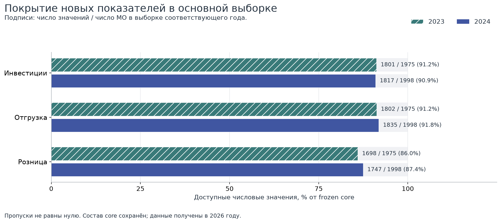
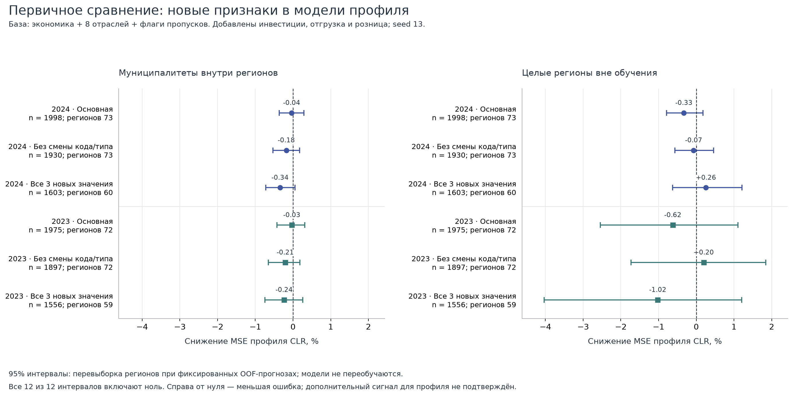
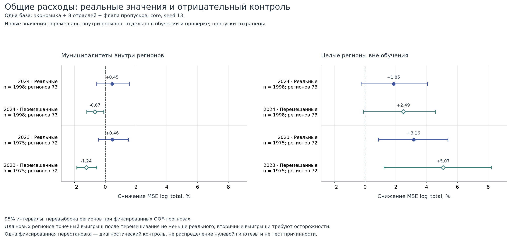

# Что дают инвестиции, отгрузка и розница для муниципальных профилей

Кейс 1 СберИндекса · третий раунд анализа · 16 сентября 2026 года

## Технический итог: оснований расширять ядро модели нет

**Инвестиции, отгрузка и розничный оборот не показали устойчивого прироста качества описания потребительского профиля после учёта прежних экономических и отраслевых характеристик.** В четырёх основных сравнениях точечная ошибка немного выросла; все 95% интервалы включают ноль. Заранее установленный критерий включения блока не выполнен. Это вывод для проверенной линейной модели и этих выборок, а не доказательство экономической незначимости показателей.

Для номинального уровня расходов есть положительные оценки при проверке на целых регионах. Однако перемешивание новых чисел внутри регионов сохраняет этот сигнал. Его муниципальная специфичность не подтверждена. Сохраняем новые данные для описания отдельных территорий; не меняем на их основе основную сеть и не объявляем новые устойчивые типы экономик.

## Что именно сравнивалось

Единица анализа — муниципалитет за год; каждый МО получает одинаковый вес. Использованы прежние 1975 МО за 2023 год и 1998 за 2024 год. Целевая структура — среднее 12 месячных нормированных показателей пяти категорий Сбера, преобразованное в CLR-координаты (логарифм компоненты относительно геометрического среднего). Это соотношения опубликованных показателей, а не полный бюджет домохозяйства.

База включает население, зарплату организаций, число учтённых работников на жителя, тип МО, восемь отраслевых долей работников и их флаги пропусков. Число работников характеризует рабочие места организаций, не долю занятых жителей. В главном сравнении обе модели также содержат три флага отсутствия новых чисел. Разница между ними — только три новых логарифма денежных объёмов на жителя.

Положительное снижение ошибки означает улучшение: 100 × (1 − SSE новой модели / SSE базы). SSE суммируется по пяти CLR-координатам. В таблице абсолютная MSE дополнительно делится на число МО и на пять координат; это не меняет относительный выигрыш. R² рассчитан вне обучения по сумме координатных ошибок и вариаций. Вторичная цель — логарифм годового среднего месячного уровня опубликованных расходов.

## Покрытие высокое, но пропуски систематичны

В сетке 2016 МО × 2 года × 3 показателя принято 10 829 чисел из 12 096 позиций. Остались 1267 пропусков: 1245 не возвращены или не приняты, 22 содержат неразрешённый маркер источника. Нулевую деятельность из этих статусов вывести нельзя. Все три модельных признака доступны для 1556 из 1975 МО в 2023 году и 1603 из 1998 в 2024 году.

В полученных ответах за 2024 год отсутствуют все три слоя у 37 МО Тверской и 36 МО Самарской области. Это ограничение сбора принятых ответов. Поэтому наличие числа контролируется отдельно от его величины; результат нельзя автоматически распространить на непокрытые территории.

| Год | Показатель | Доступно | Всего МО | Покрытие, % |
| --- | --- | --- | --- | --- |
| 2023 | Инвестиции | 1801 | 1975 | 91.19 |
| 2023 | Отгрузка | 1802 | 1975 | 91.24 |
| 2023 | Розница | 1698 | 1975 | 85.97 |
| 2024 | Инвестиции | 1817 | 1998 | 90.94 |
| 2024 | Отгрузка | 1835 | 1998 | 91.84 |
| 2024 | Розница | 1747 | 1998 | 87.44 |

Денежные значения взяты из БДПМО в тысячах рублей за год; инвестиции — годовой показатель, отгрузка и розница — январь–декабрь. Для модели используется log(значение × 1000 / население на начало года). Это номинальная интенсивность учтённой деятельности на территории, с ограничением охвата малых предприятий. Инвестиции не равны доходу жителей, отгрузка не равна добавленной стоимости, а торговля по месту продажи не равна покупкам жителей. Эти объёмы нельзя складывать. Числа не дефлированы.

Исторические коды соединены по прежнему годовому справочнику. Маски качества не расширялись. Вне принятой годовой связи оказались 29 исходных строк, все с нечисловыми маркерами. В полной панели ещё 108 позиций имеют денежное число, но не имеют допустимого населения для логарифмического признака; в основной и консервативной выборках такого расхождения нет.

## Новые числа не улучшают состав профиля

После контроля пропусков снижение ошибки профиля составляет −0,033% и −0,037% внутри регионов, на −0,622% и −0,328% при удержании целых регионов в 2023 и 2024 годах соответственно. Минус здесь означает ухудшение. Все интервалы пересекают ноль. Практического основания добавлять три признака в ядро модели по этому результату нет.

Столбцы показывают точечные оценки основной выборки; интервалы и абсолютные метрики приведены в таблице. Статическая исследовательская фигура дополнительно показывает интервалы всех трёх выборок.

| Год | Проверка | МО | Снижение, % | 95% интервал, % | MSE базы | MSE с числами | R² базы | R² с числами |
| --- | --- | --- | --- | --- | --- | --- | --- | --- |
| 2023 | Внутри регионов | 1975 | -0.033 | [-0.426; 0.310] | 0.026918 | 0.026927 | 0.760564 | 0.760485 |
| 2023 | Целые регионы | 1975 | -0.622 | [-2.547; 1.107] | 0.048326 | 0.048627 | 0.570137 | 0.567462 |
| 2024 | Внутри регионов | 1998 | -0.037 | [-0.366; 0.292] | 0.026023 | 0.026033 | 0.769909 | 0.769825 |
| 2024 | Целые регионы | 1998 | -0.328 | [-0.790; 0.179] | 0.042421 | 0.04256 | 0.624923 | 0.623693 |

## Смена выборки не даёт устойчивого положительного результата

Сохраняем две заранее заданные проверки: МО без смены кода и типа, а также МО с полными тремя новыми показателями. Для первой точно повторены прежние разбиения; для второй построены свои общие для сравниваемых моделей разбиения. Все 12 интервалов основного сравнения профиля включают ноль. На полной подвыборке все три новых денежных показателя наблюдаются, но пропуски прежних восьми отраслей сохраняются. Изменение состава выборки и разбиения не позволяет считать разность её метрик чистым эффектом заполнения пропусков.

| Год | Выборка | Проверка | МО | Снижение ошибки, % | 95% интервал, % |
| --- | --- | --- | --- | --- | --- |
| 2023 | Основная | Внутри регионов | 1975 | -0.033 | [-0.426; 0.310] |
| 2023 | Основная | Целые регионы | 1975 | -0.622 | [-2.547; 1.107] |
| 2023 | Без смены кода | Внутри регионов | 1897 | -0.206 | [-0.650; 0.182] |
| 2023 | Без смены кода | Целые регионы | 1897 | 0.197 | [-1.727; 1.843] |
| 2023 | Полные новые 3 | Внутри регионов | 1556 | -0.235 | [-0.746; 0.258] |
| 2023 | Полные новые 3 | Целые регионы | 1556 | -1.021 | [-4.034; 1.206] |
| 2024 | Основная | Внутри регионов | 1998 | -0.037 | [-0.366; 0.292] |
| 2024 | Основная | Целые регионы | 1998 | -0.328 | [-0.790; 0.179] |
| 2024 | Без смены кода | Внутри регионов | 1930 | -0.178 | [-0.535; 0.172] |
| 2024 | Без смены кода | Целые регионы | 1930 | -0.07 | [-0.565; 0.460] |
| 2024 | Полные новые 3 | Внутри регионов | 1603 | -0.344 | [-0.725; 0.052] |
| 2024 | Полные новые 3 | Целые регионы | 1603 | 0.256 | [-0.631; 1.213] |

При двух дополнительных заранее выбранных разбиениях внутри регионов знак основной оценки также отрицателен в обоих годах. Лучшее разбиение для итогового результата не выбиралось.

| Год | Seed | Снижение ошибки, % | 95% интервал, % |
| --- | --- | --- | --- |
| 2023 | 13 | -0.033 | [-0.426; 0.310] |
| 2023 | 29 | -0.055 | [-0.430; 0.271] |
| 2023 | 47 | -0.183 | [-0.574; 0.187] |
| 2024 | 13 | -0.037 | [-0.366; 0.292] |
| 2024 | 29 | -0.061 | [-0.358; 0.233] |
| 2024 | 47 | -0.056 | [-0.362; 0.255] |

## Эффект наличия данных отделён от эффекта чисел

Сравнение с более простой экономической базой, добавление только новых флагов пропусков и добавление всего блока не дают устойчивого выигрыша профиля. Во всех приведённых ниже сравнениях интервалы включают ноль. При последовательном исключении инвестиций, отгрузки и розницы также нет отдельного показателя с устойчивым положительным вкладом в профиль. Условные вклады зависят от остальных признаков и не обязаны складываться.

| Год | Проверка | Добавление | Снижение ошибки, % | 95% интервал, % |
| --- | --- | --- | --- | --- |
| 2023 | Внутри регионов | Числа сверх простой базы | 0.389 | [-0.209; 0.946] |
| 2023 | Целые регионы | Числа сверх простой базы | -0.089 | [-4.088; 3.164] |
| 2024 | Внутри регионов | Числа сверх простой базы | 0.189 | [-0.215; 0.619] |
| 2024 | Целые регионы | Числа сверх простой базы | -0.083 | [-1.585; 1.437] |
| 2023 | Внутри регионов | Только новые флаги пропусков | 0.114 | [-0.688; 0.935] |
| 2023 | Целые регионы | Только новые флаги пропусков | -0.576 | [-5.226; 3.329] |
| 2024 | Внутри регионов | Только новые флаги пропусков | 0.551 | [-0.059; 1.199] |
| 2024 | Целые регионы | Только новые флаги пропусков | 0.55 | [-2.564; 3.111] |
| 2023 | Внутри регионов | Весь новый блок сверх отраслей | 0.081 | [-0.875; 1.008] |
| 2023 | Целые регионы | Весь новый блок сверх отраслей | -1.202 | [-5.731; 2.976] |
| 2024 | Внутри регионов | Весь новый блок сверх отраслей | 0.514 | [-0.177; 1.256] |
| 2024 | Целые регионы | Весь новый блок сверх отраслей | 0.224 | [-2.748; 2.763] |

| Год | Проверка | Возвращённый показатель | Снижение ошибки, % | 95% интервал, % |
| --- | --- | --- | --- | --- |
| 2023 | Внутри регионов | Инвестиции | -0.063 | [-0.213; 0.078] |
| 2023 | Целые регионы | Инвестиции | 0.043 | [-0.152; 0.253] |
| 2024 | Внутри регионов | Инвестиции | -0.048 | [-0.193; 0.090] |
| 2024 | Целые регионы | Инвестиции | -0.208 | [-0.430; 0.002] |
| 2023 | Внутри регионов | Отгрузка | -0.072 | [-0.159; 0.014] |
| 2023 | Целые регионы | Отгрузка | -0.107 | [-0.335; 0.126] |
| 2024 | Внутри регионов | Отгрузка | -0.0 | [-0.198; 0.195] |
| 2024 | Целые регионы | Отгрузка | -0.093 | [-0.294; 0.120] |
| 2023 | Внутри регионов | Розница | 0.107 | [-0.209; 0.381] |
| 2023 | Целые регионы | Розница | -0.687 | [-2.953; 1.154] |
| 2024 | Внутри регионов | Розница | 0.061 | [-0.176; 0.275] |
| 2024 | Целые регионы | Розница | 0.06 | [-0.429; 0.561] |

## Сигнал уровня расходов сохраняется после перемешивания

Для вторичной цели на целых регионах исходные числа дают снижение ошибки на 3,161% в 2023 году (95% интервал 0,860–5,385%) и на 1,852% в 2024 году (−0,259–4,056%). Внутри регионов интервалы включают ноль. На некоторых подвыборках оценки положительны, но это не заменяет основную проверку профиля.

Диагностический контроль перемешивает наблюдаемые новые числа отдельно внутри каждого региона и отдельно в обучении и проверке, сохраняя места пропусков. Для целых регионов его точечный выигрыш равен 5,071% и 2,491% — он не исчезает и оказывается выше исходных оценок. Контроль сохраняет региональные распределения; результат не подтверждает, что выигрыш связан именно с соответствием числа конкретному МО.

Это одна фиксированная перестановка, без отдельного интервала разности «исходные минус перемешанные». Она не доказывает превосходство перемешанной модели или отсутствие муниципальной связи. Розничный оборот и расходы описывают близкие одновременные процессы, поэтому такую проверку также нельзя считать независимым экономическим подтверждением.

| Год | Проверка | Числа | Снижение ошибки, % | 95% интервал, % |
| --- | --- | --- | --- | --- |
| 2023 | Внутри регионов | Исходные числа | 0.457 | [-0.443; 1.509] |
| 2023 | Целые регионы | Исходные числа | 3.161 | [0.860; 5.385] |
| 2024 | Внутри регионов | Исходные числа | 0.449 | [-0.546; 1.562] |
| 2024 | Целые регионы | Исходные числа | 1.852 | [-0.259; 4.056] |
| 2023 | Внутри регионов | Перемешанные | -1.238 | [-1.850; -0.554] |
| 2023 | Целые регионы | Перемешанные | 5.071 | [1.228; 8.206] |
| 2024 | Внутри регионов | Перемешанные | -0.669 | [-1.193; -0.095] |
| 2024 | Целые регионы | Перемешанные | 2.491 | [-0.117; 4.573] |

| Год | Выборка | Проверка | МО | Снижение ошибки, % | 95% интервал, % |
| --- | --- | --- | --- | --- | --- |
| 2023 | Основная | Внутри регионов | 1975 | 0.457 | [-0.443; 1.509] |
| 2023 | Основная | Целые регионы | 1975 | 3.161 | [0.860; 5.385] |
| 2023 | Без смены кода | Внутри регионов | 1897 | 0.104 | [-1.060; 1.364] |
| 2023 | Без смены кода | Целые регионы | 1897 | 2.593 | [0.301; 5.080] |
| 2023 | Полные новые 3 | Внутри регионов | 1556 | 0.12 | [-0.954; 1.450] |
| 2023 | Полные новые 3 | Целые регионы | 1556 | 4.201 | [1.096; 6.759] |
| 2024 | Основная | Внутри регионов | 1998 | 0.449 | [-0.546; 1.562] |
| 2024 | Основная | Целые регионы | 1998 | 1.852 | [-0.259; 4.056] |
| 2024 | Без смены кода | Внутри регионов | 1930 | -0.058 | [-1.229; 1.270] |
| 2024 | Без смены кода | Целые регионы | 1930 | 2.376 | [0.314; 4.334] |
| 2024 | Полные новые 3 | Внутри регионов | 1603 | 0.364 | [-0.994; 1.711] |
| 2024 | Полные новые 3 | Целые регионы | 1603 | 2.894 | [0.187; 5.156] |

## Ошибки распределены неодинаково

В удержанных регионах у внутригородских территорий ошибка профиля возрастает на 13,075% в 2023 году и 1,600% в 2024 году; в этой группе по 242 МО. Это описательный срез сохранённых прогнозов, без отдельного интервала и без проверки множества гипотез. Он указывает на неоднородность, но не даёт основания исключить неудобную группу и пересчитать главный результат. Срезы по региону, числу доступных признаков и квартилю населения сохранены в таблице ошибок. Квартили рассчитаны только для описания, они не участвовали в обучении.

| Год | Тип МО | МО | Снижение ошибки, % |
| --- | --- | --- | --- |
| 2023 | Внутригородские территории | 242 | -13.075 |
| 2023 | Городские округа | 427 | 1.769 |
| 2023 | Муниципальные округа | 263 | 0.948 |
| 2023 | Муниципальные районы | 1043 | 0.385 |
| 2024 | Внутригородские территории | 242 | -1.6 |
| 2024 | Городские округа | 431 | 0.488 |
| 2024 | Муниципальные округа | 351 | -0.509 |
| 2024 | Муниципальные районы | 974 | -0.249 |

## Отдельные территории нельзя описать одним темпом роста

У шести ранее выбранных МО доступны 34 из 36 денежных значений и 17 из 18 годовых пар. Для розницы Свободненского района данных нет в обоих годах. Таблица показывает номинальное изменение 2024 года к 2023-му. Коды, периоды и единицы совпадают; неизменность границ и круга респондентов не доказана.

В Верхнеколымском инвестиции выросли на 208,26%, а отгрузка снизилась на 24,89%. В Нижнеколымском инвестиции упали на 98,14%, при росте розницы на 16,75%. В Куркине рост розницы на 143,56% сочетается со снижением инвестиций на 48,59%. Такие сочетания помогают формулировать адресные вопросы к источникам, но не устанавливают завершение проекта, изменение дохода жителей или причину потребительского остатка. Эти случаи ранее выбраны по остаткам модели и не являются независимой проверочной выборкой.

| Муниципалитет | Инвестиции | Отгрузка | Розница |
| --- | --- | --- | --- |
| Верхнеколымский | +208.26% | -24.89% | +10.04% |
| Нижнеколымский | -98.14% | -8.63% | +16.75% |
| Свободненский, Амурская обл. | +34.26% | +102.77% | Нет пары |
| Красноярский, Астраханская обл. | -22.40% | -0.67% | +33.92% |
| Светловский | -60.72% | +6.18% | +14.71% |
| Куркино | -48.59% | +7.51% | +143.56% |

Местные документы не снимают прежние противоречия. В Светловском число работников совпадает с опубликованной статистикой, но зарплата 2024 года отличается от зафиксированного ряда на 412,5 рубля; причина остаётся неизвестной. По Свободненскому нельзя смешивать декабрьское число работников со среднегодовым; два подозрительных числа из Амурского PDF остаются в карантине. В Куркине 8 — муниципальные служащие в штатном расписании на 31.12.2024, а 336 — трудоустроенные в «Жилищнике» на неустановленную дату отчёта. Эти сведения об отдельных учреждениях не заменяют общий итог территории.

## Как ограничена неопределённость

Использована Ridge-регрессия с фиксированным alpha = 1. Медианы заполнения, масштабы и словари категорий оцениваются только на обучающих строках. Пять разбиений основной и консервативной выборок совпадают с прошлым раундом. Внутри регионов учитывается регион; при удержании целых регионов региональные фиктивные переменные исключены. Удержание региона не означает пространственного буфера от соседей.

95% интервалы получены 2000 парными перевыборками регионов из фиксированных ошибок вне обучения. Модель при этом не переобучается. Интервалы условны относительно выборки, признаков и разбиения, не включают всю неопределённость процедуры и не скорректированы за множество вторичных сравнений.

Результаты обоих лет уже рассматривались в предыдущих раундах. Анализ остаётся исследовательским; 2024 год нельзя объявлять нетронутой проверкой. Годовые данные собраны в 2026 году, время первой публикации и история пересмотров неизвестны. Здесь нет утверждения о прогнозе будущего, доступности признаков на дату прогноза или причинном воздействии. Настройки после просмотра новых результатов не подбирались.

## Решение для первого кейса

**Основную модель и сеть оставляем без нового денежного блока.** Заранее заданное правило требовало не менее 1% снижения ошибки профиля во всех четырёх основных сравнениях, положительной нижней границы интервала и согласованности на МО без смены кода. Эти условия не выполнены.

Новые величины сохраняем в карточках территорий вместе с охватом и пропусками. Следующий содержательный шаг — проверка воспроизводимости экономической интерпретации прежней сети, а не расширение набора признаков ради положительной метрики. Отдельной проверки требуют отсутствие слоёв Тверской и Самарской областей, круг респондентов при резких изменениях и сопоставимость географии. До её завершения прежние ограничения по кодам, границам и несвязанной статистике МСП сохраняются.
