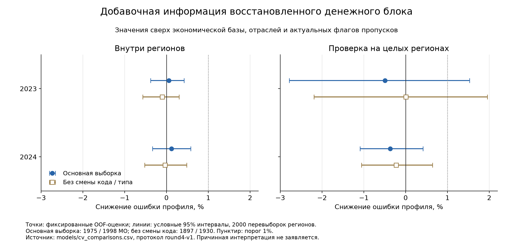

# Что изменили восстановленные данные о муниципалитетах

Кейс 1 СберИндекса · четвёртый раунд анализа · 16 сентября 2026 года

## Более полные данные пока не меняют решение о модели

**Восстановление денежных показателей не дало устойчивого улучшения описания потребительского профиля.** После контроля прежних экономических характеристик, отраслей и пропусков точечный выигрыш составляет +0.058% / +0.119% внутри регионов и −0.496% / −0.370% на целых регионах за 2023 / 2024 годы. Все четыре условных 95% интервала включают ноль. Критерий добавления блока в ядро модели не выполнен.

Сигнал номинального уровня расходов остаётся положительным на целых регионах, но сохраняется после перестановок чисел внутри регионов. Муниципальная специфичность этого сигнала не подтверждена. Это ограниченный вывод о проверенной линейной модели, а не доказательство экономической неважности инвестиций или торговли.

## Сравнение сохраняет прежние муниципалитеты и цели

Единица анализа: муниципалитет за год, с одинаковым весом каждого МО. Основная выборка содержит 1975 МО в 2023 году и 1998 в 2024-м. Цель — структура пяти опубликованных категорий расходов: среднее нормированных месячных показателей, выраженное в CLR-координатах, то есть логарифмах относительно геометрического среднего компонент. Это потребительский профиль опубликованных показателей, а не полный бюджет домохозяйства.

Основная метрика — средняя квадратичная ошибка по пяти координатам (MSE) на МО, не использованных для обучения соответствующей модели. Положительное снижение ошибки означает улучшение. Вторичная цель — логарифм среднего месячного номинального уровня опубликованных расходов. Оба года уже изучались ранее; этот раунд является исследовательской проверкой, а не новым независимым тестом.

## Восстановлено покрытие, а состав основной выборки сохранён

779 дополнительных чисел дали 770 новых непустых значений трёх логарифмических признаков. Для девяти ячеек нет подходящего населения; они лежат вне основной выборки. В полной панели изменения затронули 445 пар «МО–год», 223 МО и 11 регионов. Тверская и Самарская области дали 432 из 779 чисел, или 55.46%. Это адресное устранение пробелов, а не случайная выборка новых наблюдений.

Таблица показывает долю основной выборки со всеми тремя денежными атрибутами. Полные наблюдения выросли с 1556 до 1768 в 2023 году и с 1603 до 1814 в 2024-м. Знаменатели и годовые связи сохранены; ограничения 78 преобразований кодов и 6 календарных случаев не сняты.

| Год | Версия | Полных МО | Всего МО | Доля, % |
| --- | --- | --- | --- | --- |
| 2023 | До восстановления | 1556 | 1975 | 78.78 |
| 2023 | После восстановления | 1768 | 1975 | 89.52 |
| 2024 | До восстановления | 1603 | 1998 | 80.23 |
| 2024 | После восстановления | 1814 | 1998 | 90.79 |

## Прирост качества профиля остаётся малым и неопределённым

В основной проверке модель с числами сравнивается с той же моделью, в которой уже есть актуальные флаги их пропусков. Так наличие информации отделено от добавления числовых значений. Таблица даёт четыре точечные оценки, абсолютную ошибку и условные интервалы. Во всех случаях интервал включает ноль.

Во всех четырёх выборках все 16 основных интервалов seed 13 также включают ноль. Дополнительные разбиения внутри регионов не дают устойчивого выигрыша. Новые значения помогают описать МО, но оснований использовать этот блок для улучшения основной модели пока нет.

| Год | Проверка | МО | Снижение, % | 95% интервал, % | MSE базы | MSE с числами |
| --- | --- | --- | --- | --- | --- | --- |
| 2023 | Внутри регионов | 1975 | 0.058 | [-0.383; 0.423] | 0.02697 | 0.026955 |
| 2023 | Целые регионы | 1975 | -0.496 | [-2.782; 1.527] | 0.049108 | 0.049352 |
| 2024 | Внутри регионов | 1998 | 0.119 | [-0.334; 0.582] | 0.026114 | 0.026083 |
| 2024 | Целые регионы | 1998 | -0.37 | [-1.090; 0.414] | 0.043074 | 0.043233 |

| Год | Выборка | Проверка | МО | Снижение, % | 95% интервал, % |
| --- | --- | --- | --- | --- | --- |
| 2023 | Основная | Внутри регионов | 1975 | 0.058 | [-0.383; 0.423] |
| 2023 | Основная | Целые регионы | 1975 | -0.496 | [-2.782; 1.527] |
| 2023 | Без смены кода | Внутри регионов | 1897 | -0.103 | [-0.569; 0.300] |
| 2023 | Без смены кода | Целые регионы | 1897 | 0.007 | [-2.191; 1.954] |
| 2023 | Прежние полные 3 | Внутри регионов | 1556 | -0.161 | [-0.671; 0.325] |
| 2023 | Прежние полные 3 | Целые регионы | 1556 | -0.882 | [-3.752; 1.416] |
| 2023 | Новые полные 3 | Внутри регионов | 1768 | -0.062 | [-0.573; 0.395] |
| 2023 | Новые полные 3 | Целые регионы | 1768 | -1.326 | [-5.225; 1.773] |
| 2024 | Основная | Внутри регионов | 1998 | 0.119 | [-0.334; 0.582] |
| 2024 | Основная | Целые регионы | 1998 | -0.37 | [-1.090; 0.414] |
| 2024 | Без смены кода | Внутри регионов | 1930 | -0.035 | [-0.525; 0.483] |
| 2024 | Без смены кода | Целые регионы | 1930 | -0.225 | [-1.058; 0.644] |
| 2024 | Прежние полные 3 | Внутри регионов | 1603 | -0.142 | [-0.643; 0.331] |
| 2024 | Прежние полные 3 | Целые регионы | 1603 | 0.456 | [-0.191; 1.038] |
| 2024 | Новые полные 3 | Внутри регионов | 1814 | -0.147 | [-0.720; 0.328] |
| 2024 | Новые полные 3 | Целые регионы | 1814 | -0.361 | [-1.014; 0.321] |

| Год | Seed | Снижение, % | 95% интервал, % |
| --- | --- | --- | --- |
| 2023 | 13 | 0.058 | [-0.383; 0.423] |
| 2023 | 29 | 0.045 | [-0.370; 0.396] |
| 2023 | 47 | -0.103 | [-0.535; 0.312] |
| 2024 | 13 | 0.119 | [-0.334; 0.582] |
| 2024 | 29 | 0.118 | [-0.317; 0.553] |
| 2024 | 47 | 0.067 | [-0.373; 0.515] |

## Дополнение чисел и обновление признаков пропусков дают разные сравнения

Прямое сравнение полной модели до и после восстановления даёт −1.491% / −1.581% на целых регионах; оба интервала включают ноль. В этом сравнении одновременно меняются значения, флаги пропусков и обученные коэффициенты. Его нельзя назвать чистым эффектом дополнительных чисел.

Поэтому отдельно проверены две модели с одинаковыми наборами старых и новых флагов. При замене только версии чисел в 2023 году на целых регионах выигрыш равен +0.689% [0.145; 1.455], а в 2024 году −0.003% [−0.318; 0.370]. Это локальный исследовательский результат чувствительности; он не повторяется в обоих годах и не выполняет основной критерий.

Прежние числовые значения сохранены и дают те же признаки. На прежней полной подвыборке старый и новый варианты после обучения только на этой же подвыборке совпадают. При обучении на всём core прогноз такого МО может измениться из-за новых данных других территорий.

| Год | Проверка | Сравнение | Снижение, % | 95% интервал, % |
| --- | --- | --- | --- | --- |
| 2023 | Внутри регионов | Полное обновление версии | -0.105 | [-0.473; 0.224] |
| 2023 | Целые регионы | Полное обновление версии | -1.491 | [-4.136; 1.321] |
| 2024 | Внутри регионов | Полное обновление версии | -0.194 | [-0.548; 0.139] |
| 2024 | Целые регионы | Полное обновление версии | -1.581 | [-3.320; 0.279] |
| 2023 | Внутри регионов | Новые числа при общих двух наборах флагов | 0.093 | [-0.047; 0.239] |
| 2023 | Целые регионы | Новые числа при общих двух наборах флагов | 0.689 | [0.145; 1.455] |
| 2024 | Внутри регионов | Новые числа при общих двух наборах флагов | 0.138 | [-0.074; 0.362] |
| 2024 | Целые регионы | Новые числа при общих двух наборах флагов | -0.003 | [-0.318; 0.370] |

Следующая таблица описательно разбивает изменение ошибки старой и новой полной модели на целых регионах. Последний столбец — вклад группы в общую относительную разность ошибок; вклады складываются в −1.491% / −1.581%. Это разложение сохранённых ошибок, не оценка причинного воздействия заполнения пропуска. Полная региональная разбивка сохранена отдельно.

| Год | Группа | МО | Внутри группы, % | Вклад в общую разность, п.п. |
| --- | --- | --- | --- | --- |
| 2023 | Полные прежде | 1556 | -0.751 | -0.549 |
| 2023 | Стали полными | 212 | 0.781 | 0.076 |
| 2023 | Остались неполными | 207 | -5.933 | -1.018 |
| 2024 | Полные прежде | 1603 | -0.144 | -0.11 |
| 2024 | Стали полными | 211 | -5.452 | -0.459 |
| 2024 | Остались неполными | 184 | -6.822 | -1.012 |

## Сигнал уровня расходов сохраняется без точного соответствия МО

Для номинального уровня расходов на целых регионах выигрыш составляет +3.351% [0.981; 5.762] в 2023 году и +2.038% [−0.033; 4.357] в 2024-м. Внутри регионов оценки около +0.59%, а интервалы включают ноль. Вторичная цель не заменяет основной результат о составе профиля.

Три заранее выбранные перестановки чисел внутри каждого региона дают 2.696–3.896% в 2023 году и 1.995–2.894% в 2024-м. Таблица сопоставляет исходные данные с этими проверками. Места пропусков и региональные распределения сохранены; доноры обучения и проверки не смешиваются. Сигнал не исчезает, поэтому его муниципальная специфичность остаётся неподтверждённой.

Это три диагностические перестановки, не permutation p-value и не доказательство превосходства перемешанной модели. Розница и расходы описывают близкие одновременные процессы. Среди отдельных денежных признаков положительный условный сигнал уровня расходов связан прежде всего с розницей, но такой результат нельзя считать независимой проверкой экономической структуры.

| Год | Вариант | Снижение, % | 95% интервал, % |
| --- | --- | --- | --- |
| 2023 | Исходные числа | 3.351 | [0.981; 5.762] |
| 2024 | Исходные числа | 2.038 | [-0.033; 4.357] |
| 2023 | Перестановка 1 | 2.696 | [-0.123; 5.890] |
| 2024 | Перестановка 1 | 1.995 | [-0.635; 4.424] |
| 2023 | Перестановка 2 | 3.896 | [1.266; 6.372] |
| 2024 | Перестановка 2 | 2.185 | [-0.288; 4.547] |
| 2023 | Перестановка 3 | 3.51 | [1.107; 6.174] |
| 2024 | Перестановка 3 | 2.894 | [0.263; 5.178] |

## Длинный ряд меняет описание нижнеколымского падения

Инвестиции Нижнеколымского района в 2023 году в 41.81 раза превышали сумму 2022 года. После резкого снижения сумма 2024 года оказалась на 4.25% ниже 2021-го и на 22.01% ниже 2022-го в текущих ценах. Поэтому точнее говорить об отдельном высоком значении 2023 года и возврате к сопоставимому порядку сумм прежних лет. Это описание опубликованного ряда, а не установленная причина падения.

У Верхнеколымского района опубликованные номинальные инвестиции увеличиваются каждый год в 2020–2024. Таблица сохраняет единицу: млн руб. без малого предпринимательства и инвестиций, не наблюдаемых прямыми статистическими методами. Исторические проценты вычислены из округлённых ежегодников; границы их округления не являются статистическими доверительными интервалами. Состав респондентов, проекты и реальные объёмы после дефляции не установлены.

| Год | Верхнеколымский | Нижнеколымский |
| --- | --- | --- |
| 2020 | 29.9 | 12.0 |
| 2021 | 100.8 | 25.9 |
| 2022 | 251.4 | 31.8 |
| 2023 | 294.9 | 1329.7 |
| 2024 | 909.2 | 24.8 |

## МСП позволяет изучать охват, но ещё не муниципальную занятость

На уровне уникальных ИНН численность работников известна у 79.28% юридических лиц в файле 2023 года и у 80.54% в 2024-м. У ИП она отсутствует полностью. Если считать строки компаниями, число юрлиц было бы завышено на 7.80% / 6.27%. Фильтр только известных работников тоже меняет состав. Среди юрлиц с однозначным двузначным основным кодом ОКВЭД в файле 2024 года наблюдаемость работников составляет 51.40% для кода 52 и 94.96% для кода 86. Представлены уникальные ИНН за год; это не число действующих фирм на конец года и не число рабочих мест в МО.

После одновременной проверки известных неотрицательных работников, одного территориального кода и одного двузначного основного ОКВЭД внутри годового файла остаются 1 953 215 / 1 948 891 юрлицо. Это кандидаты на дальнейшую обработку записей. География июня 2026 года и выбор периода внутри года по-прежнему не позволяют считать их готовым историческим муниципальным слоем.

| Год | Тип | Различных ИНН | Работники известны | Доля, % | ИНН-кандидатов |
| --- | --- | --- | --- | --- | --- |
| 2023 | Юридические лица | 2551369 | 2022712 | 79.28 | 1953215 |
| 2023 | ИП | 4528901 | 0 | 0.0 | 0 |
| 2024 | Юридические лица | 2504123 | 2016732 | 80.54 | 1948891 |
| 2024 | ИП | 4862224 | 0 | 0.0 | 0 |

## Равенство геометрий поставщика не снимает ограничения

Для четырёх проверенных ID поставщик отдаёт одинаковые геометрии за 2023 и 2024 годы. Это подтверждает воспроизводимость выбора полигона. Парных датированных координатных описаний юридических границ пока нет. Маски исторической и календарной сопоставимости остаются прежними; источник МСП с современной географией не используется для их замены.

## Методика фиксирует сравнение и границы уверенности

Ridge с alpha=1 обучается отдельно для каждого года на пяти разбиениях. База: логарифмы населения, зарплаты и концентрации учтённых рабочих мест; тип МО; восемь отраслевых долей и флаги их пропусков. Денежный блок включает инвестиции в основной капитал, отгрузку продукции, работ и услуг собственного производства и оборот розничной торговли; охват — без малого предпринимательства. Признаки равны log(тыс. руб. × 1000 / население на начало года) при положительных конечных числителе и знаменателе. Исходный ноль сохраняется в данных, но не даёт логарифмического признака. Это номинальная территориальная интенсивность, а не доход жителей. Три суммы не складываются.

Медианы, масштабы и словарь категорий оцениваются только на обучающей части. Внутри регионов модель использует региональные индикаторы; при удержании целых регионов их нет. Основная и консервативная выборки повторяют прежние ключи разбиений. Полные подвыборки ограничивают те же core-разбиения, но обучаются на разном составе МО: разность их метрик не является чистым эффектом расширения выборки.

95% интервалы построены по 2000 парным перевыборкам регионов для уже сохранённых ошибок. Они не включают повторное обучение всей процедуры и не скорректированы на множественные сравнения. Все дополнительные разбиения, перестановки и исключения отдельных признаков заданы до новых результатов. Предыдущие прогнозы воспроизведены, гиперпараметры не подбирались.

Источники скачаны в 2026 году, показатели относятся к тем же годам, что и расходы. История публикаций и пересмотров неизвестна. Этот дизайн не оценивает прогноз будущего или причинное влияние.

## Денежный блок остаётся описательным контекстом

**Основную модель и сеть оставляем в прежней спецификации.** Правило требовало не менее 1% снижения ошибки профиля в обоих годах и режимах, положительной нижней границы интервала и отсутствия разворота результата на выборке без смены кода. Новые данные этого правила не выполнили.

- Для экономических карточек МО используем более полные денежные ряды с явным охватом и историческими ограничениями.
- Для МСП сначала фиксируем момент наблюдения и проверяем исторические ключи; отдельно оцениваем отбор по наличию работников.
- Для объяснения резких изменений ищем сведения о респондентах и проектах; для границ нужны независимые исторические описания.

Открытые вопросы: меняется ли экономическая интерпретация прежних групп при исключении регионального контекста; какие муниципальные признаки МСП можно построить без подмены исторической географии; что объясняет единичный инвестиционный пик. Новый раунд уточнил эти вопросы, не устранив их автоматически.

Источники и определения: БДПМО Росстата; ежегодники Якутиястата; реестр МСП ФНС в обработке «Если быть точным», версия v20260605 ([набор](https://tochno.st/datasets/sme)). Подробные ограничения и происхождение контекстных таблиц: [context/README.md](context/README.md). [Воспроизведение](REPRODUCE.md) · [Независимая проверка](independent_review.md).
